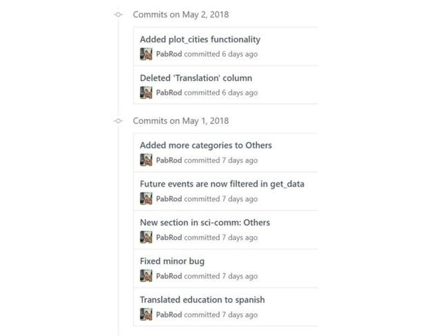

A minimal introduction to unit testing and version control


Photo by Markus Spiske on Unsplash

### A quick background

My scientific life finished abruptly in 2012. Or at least, that’s what I thought back then. Just after getting my MSc in physics, instead of proceeding directly towards doctoral studies (as I would have liked to), my personal circumstances forced me to look for a full-time job. Luckily, I found one pretty quickly. Three days before my last exam, I signed a contract as an engineer in a lens-designing company.

I must admit that back then I thought that I couldn’t learn much from a company. Like many young students, I thought that universities were the only home of knowledge. Like many young students, I was wrong. Today, after returning to scientific research, several of the tools that I was introduced to during my stage as an engineer make my daily life way easier. Tools whose existence I was not even aware of. But first, let me tell you a story about software development.

In real life, there is nothing closer to the fantastic concept of a “magic spell” as a programming command. You write the proper "words", and the computer does whatever you want. Of course, there are also massive differences, but let me play with this parallelism a bit more. What happens if you have a typo in a computer program? I am thinking of something like:

```text
define: wingardium_leviosaa
```

instead of:

```text
define: wingardium_leviosa
```

Well, most likely your code will crash (or worse, it will not crash and the error will remain unnoticed). Knowing this, it is mindblowing to know that there are programs out there with thousands and thousands of lines of code, written among various authors, with several versions over the years and often depending on other equally complex programs. And they work! How do software developers manage to write programs without a single mistake?

> How do software developers manage to write programs without a single mistake? The answer is simple: they don’t.

The answer is simple: they don’t. Software developers make as many mistakes as anyone else (they decided to become programmers, just to begin with). Nevertheless, there is an aspect where they differ significantly from “anyone else”: their awareness about the fallibility of their own brains. Software developers are so aware of this that they developed tools and protocols to assist them in the inhumanly difficult task of writing complex pieces of interconnected information. These tools are known under the umbrella term of “best practices”, and are built around the simple idea of “plan for mistakes”.

Two of these tools shine with their own light, especially when applied in combination: unit tests and version control. If, like the past me, you’ve never heard of those, I suggest you to keep reading. I hope that, with these tools, you don’t have to lose another evening looking for a mistake in a piece of code that yesterday worked flawlessly, nor have to open a folder with twelve versions of your thesis ever again.

### Unit tests

The idea behind unit tests is writing small scripts that check that everything works as expected.

Let’s see an example, imagine you want to write a function that just sums two numbers. Something like:

```text
sum(x,y):
  return (x + y)
```

Some possible tests could be:

```text
check that: sum(2,3) == 5
check that: sum(2,-3) == -1
check that: sum(1.2,2.3) == 3.5
check that: sum(1,"abc") throws error
```

This battery of tests is saved and rerun every time we want to check the code consistency. Any future edition of the function `sum` should pass, at least, the same tests.

The previous example may look like (and actually is) quite silly. But remember that code is alive. Something that today is a simple function tomorrow may be more complicated. Imagine that a collaborator edits your function like this:

```text
sum(x,y):
  return (x - y)
```

The edit is ok, the code will compile, but the function will just not do what it is expected to do. The tests will notice immediately that something went wrong.

Code is not only alive but complex. A week later, your function may become part of a bigger picture, with several functions calling each other. A single error may create a domino effect. Unit tests make easy identifying where exactly the error is happening.

Other side advantages:

* Running the battery of tests allows users/collaborators to check that they installed your code properly
* Tests can be used as complementary documentation
* Writing code with unit tests in mind increases the modularity and quality of code

### I am interested! How should I start?

Although the idea behind unit tests is general and simple, the specific practical implementation depends on the programming language you are using. Perhaps you can guess how to start: just Google “unit testing” + your programming language*.

### Version control

As I said, code is alive. Code grows, changes, gets updated. The idea behind version control is to keep an ordered and commented registry of all the changes that the code has suffered. It allows, for instance, comparing the same file at different stages in time. Or rolling back to a previous version in case of regretting one or several edits.

Additionally, services such as GitHub, GitLab or BitBucket allow easy publishing and sharing of code under version control. This is particularly useful if you are writing code with a team or if you want to make your code available in a practical way.


Example of a GitHub timeline. The “commits” appear in chronological order, and each of them corresponds to a modification important enough to deserve a comment. By clicking on the commits (source [here](https://github.com/PabRod/academic-record/commits/master)) you can see a detailed overview of the changes.

### I am interested! How should I start?

Currently, the most popular version control system is git, which is free and open source. The first encounter can be a bit shocking if you are not used to the console. Feel free to use a graphical user interface, especially at the beginning, if that makes you more comfortable.

### Wait a minute! Is this not too complicated?

After knowing about these methods some researchers react considering them too complicated. These same researchers tend to develop their own artisanal methods, that end up being equally (or more) complicated and much more inefficient and insecure. This should not be surprising, as the complexity is not in the method, but in the problems we are trying to solve.

Writing a scientific paper, a piece of software or a thesis is a complex process not only from a scientific point of view, but also from that of information management. Software engineers have extensive experience in exactly these kinds of problems… why not use their tools of proven efficiency instead of painfully reinventing the wheel?

### References

* [Best practices for scientific computing](https://journals.plos.org/plosbiology/article?id=10.1371%2Fjournal.pbio.1001745)

*This post is strongly based in another post of the author, *[*Algunas cosas que los científicos pueden aprender de los programadores*](https://culturacientifica.com/2018/05/18/algunas-cosas-que-los-cientificos-pueden-aprender-de-los-programadores/)*, written in Spanish for *[*Naukas.com*](https://naukas.com)
