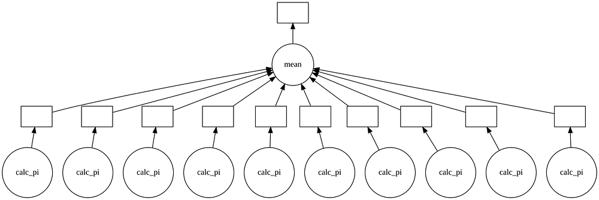

**Part 1: Killing the GIL, Combining Dask and Numba for Parallel Number-Crunching in Python**

> This blog-post is co-authored by
>
> [Pablo Rodríguez-Sánchez](https://medium.com/u/24f09ca64482?source=post_page---user_mention--7fd62c90217d---------------------------------------)
>
> .


Photo by Randy Fath on Unsplash

Have you ever been in a hurry to complete a task? Most likely yes. There are two ways of minimizing your time spent on problems: one of them is to run faster… and the other one is to ask for help.

In many cases where the task is number crunching on a computer, programmers will move from a prototype in Python to a faster implementation in a different language (C++, Fortran or whatever). But what about Python itself? We will show that often it is not needed to move to C++ just for more performance. We solve our problem with Numba and Dask. Using these libraries in tandem make Python into a **parallel number-crunching power-house**.

## Parallel vs serial

Conceptually, a computer is a machine that processes tasks. No more and no less. Most modern computers, including personal laptops, have many cores. Each core can process a task independently of the rest.

Most often, we use computers to perform collections of tasks. If those tasks are performed one after the other, we are talking about serial computation (see first figure).


If at least some tasks can be performed simultaneously (as in the second figure), we are talking about parallel computation. By assigning one task to each core, we roughly multiply by 3 the speed of the whole process.


## Pea soup and task parallelization

Here’s a recipe for Dutch snert (it sounds even funnier when pronounced in English!), as it is given by one of the larger chains of supermarkets in the Netherlands (translated by Google’s translator app):


If you look closely, it says at point 2 “Gently simmer in about 60 minutes”, followed by point 3, telling you to cut vegetables and point 4 & 5, adding the vegetables to the soup. Any reasonable cook would cut the vegetables *while* the soup is gently simmering for about 60 minutes. Most traditional computer languages lack the power to express this idea succinctly, and will not optimise these tasks. We can do it, but we need to pull some tricks out of a hat. We will show how this can be done in Python using Dask.

We put the recipe in terms of Python functions, and make sure all our functions are *pure*: they only take arguments and give back a new result. Pure functions *do not mutate* a variable.

```python
from dask import delayed
from pint import UnitRegistry, Quantity
units = UnitRegistry()
# Always use units, or else: (https://en.wikipedia.org/wiki/Mars_Climate_Orbiter#Cause_of_failure)
```

To add vegetables to the pan, we define the `add_vegetable` action:

```python
@delayed
def add_vegetable(pan: Container, ingredient) -> Container:
  return pan + [ingredient]
```

Assuming the pan is a list of ingredients that went into the soup this creates a new pan with the ingredient added. Similarly we can `simmer` and `cut vegetables`:

```python
@delayed
def simmer(pan: Container, time: Quantity) -> Container:
  print(“simmering for {:~P}”.format(time))
  return pan

@delayed
def cut_vegetable(ingredient):
  return “sliced “ + ingredient
```

Given these actions we can write down the recipe (in reduced form):

```python
def snert(pan):
  pan = add_vegetable(pan, “peas”)
  pan = simmer(pan, 60*units.min)
  veggies = cut_vegetable(“vegetables”)
  pan = add_vegetable(pan, veggies)
  pan = simmer(pan, 20*units.min)
  return pan
```

Notice that each *action* is decorated with `@delayed` to tell Python that this is a task within a recipe. However the recipe itself is not decorated. Dask builds the recipe from the elemental actions that we provide it with.


We can visualize the recipe in a *directed-acyclic-graph* (or DAG for short) by creating a node for each action, and an arrow for the data flow. In Dask this is done by calling `snert([]).visualize()`.

We now have the recipe for snert in a more abstract form (a DAG), from which the parallelism that is inherent in the recipe is immediately visible.

## Our toy algorithm: π’s in the rain


In order to witness the advantages of parallelization we need an algorithm that is 1. parallelizable and 2. complex enough to take a few seconds of CPU time. In order to not scare away the interested reader, we need this algorithm to be understandable and, if possible, interesting. We chose a classical algorithm for demonstrating parallel programming: estimating the value of number π.

The algorithm we are presenting is one of the classical examples of the power of Monte-Carlo methods. This is an umbrella term for several algorithms that use random numbers to approximate exact results. We chose this algorithm because of its simplicity and straightforward geometrical interpretation.

Unfortunately, we have to start refreshing a couple of results from high school geometry. You probably remember that the area A of a square of side L is given by Aₛ = L², and the area of a circle of radius R is given by Aₒ = πR².

A circle of radius R can be stacked inside of a square of side L= 2R (see figure). The ratio between areas is thus, Aₒ/Aₛ=πR²/4R²=π/4.

This means that one possible (but very inefficient) way of estimating the number π is: π~4Aₒ/Aₛ.

We can now imagine the following mental experiment: if we let rain droplets fall in our figure, it is reasonable to expect the number of droplets inside the circle to be proportional to its area. The same is true for the square. Consequently, the ratio between the number of droplets inside the circle, M, and the number of droplets inside the square, N, should verify: π ~ 4M/N, where the approximation should become better as the number of droplets becomes higher.

An interactive version of the algorithm, used for teaching, can be found [here](https://www.geogebra.org/m/mueUbwgg).

## Implementation (in Python)

Instead of using rain droplets, we’ll use a random number generator to simulate such a rain. In particular, we draw a coordinate *x* and a coordinate *y* from a uniform distribution, and use them as the coordinates a of a “droplet” impact.

Depending on your level of Python expertise, you might implement such an algorithm in different ways.

In an introductory Python course we could write this function as follows.

```python
import random

def calc_pi(N):
  M = 0
  for i in range(N):
    # Simulate impact coordinates
    x = random.uniform(-1, 1)
    y = random.uniform(-1, 1)
 
    # True if impact happens inside the circle 
    if x**2 + y**2 < 1.0:
      M += 1
  return 4 * M / N
```

This implementation has serious shortcomings when it comes to performance. We learn how to fix this in the second week of learning Python, when we encounter NumPy! We show here another way of implementing the same idea. In this case we are taking advantage of NumPy’s recommended vector notation. Used smartly, it avoids the need of for loops.

```python
import numpy as np

def calc_pi_numpy(N):
  # Simulate impact coordinates
  pts = np.random.uniform(-1, 1, (2, N))
  # Count number of impacts inside the circle
  M = np.count_nonzero((pts**2).sum(axis=0) < 1)
  return 4 * M / N
```

This implementation is a lot faster than the first one, but it still only uses a single processor. Surely, we can do better than that! We can parallelize this algorithm by running it several times and then computing the mean of the outputs.

The problem of computing π is representative of a family of problems known as embarrassingly parallel**. Roughly, this means that parallelizing the algorithm [should be easy](https://en.wikipedia.org/wiki/Embarrassingly_parallel). If we want to use, say, 80000 random points, and we have 8 cores, we can split our problem in 8 problems of 10000 points each. This will give 8 different results, that we will collect together using a mean.


The GIL

## The GIL

There are many ways of parallelizing programs in Python, but not many of them are actually very good for problems like this. The reason is the Global Interpreter Lock or GIL. The GIL is infamous for killing any naive attempts at parallel programming in Python in its tracks.

The designers of Python chose ease-of-use over the use of power, a design principle that is in part responsible for the popularity of the language today. In the case of the GIL this means that any operation that requires interaction with the Python interpreter is locked to what is effectively a single thread. Multi-threading in Python is useful only for doing IO operations or native function calls that resolve outside the ever present eye of the Python interpreter. There are two solutions to this problem: running multiple Python instances or doing all of your work outside of Python.

For a lot of small-scale parallel work, running multiple instances of Python is not a very good solution: there is the overhead of copying data between the different Python instances. We can do better than this! **What if we just kill the GIL?** We’ll see soon that the package Numba allows us to do it easily by just using a decorator in our function. We can then use any other tool for parallelizing Python to run the algorithm in parallel, in this case: Dask.

One way of using Dask is through its NumPy-esque `daskarray` interface. This will give some speedup because the underlying NumPy routines are not choked by the GIL. However, we can do a lot better if we eliminate the GIL entirely using Numba.

## Let’s do it

First, we want to know how many cores we have. In Python this can be easily figured out easily using the multiprocessing package:

```python
import multiprocessing
ncpus = multiprocessing.cpu_count()
print(“We have {} cores to work on!”.format(ncpus))
```

Now, we use Numba to comfortably avoid the GIL by simply using the `@jit` decorator around our function. Numba compiles the Python code to native machine code to make it perform faster. We have to forget what we learned about using NumPy here.

```python
from numba import jit

@jit(nopython=True, nogil=True) # Required to kill the GIL
def calc_pi_nogil(N):
  M = 0
  for i in range(N):
    # Simulate impact coordinates
    x = random.uniform(-1, 1)
    y = random.uniform(-1, 1)
 
    # True if impact happens inside the circle 
    if x**2 + y**2 < 1.0:
      M += 1
  return 4 * M / N
```

Ironically, our implementation is identical to the first very slow Python version, with the exception of the `@jit` line!

We set out multiple jobs for computing π and take the mean of the results.

```python
from dask import delayed

@delayed
def mean(*args):
  return sum(args) / len(args)

# Call calc_pi_nogil 10 times with N = 10 million
x = mean(*(delayed(calc_pi_nogil)(10**7) for i in range(10)))
```

The workflow can be visualized using:

```python
x.visualize()
```

A recipe for computing π faster

And evaluated using:

```python
x.compute()
```

Try it out yourself! Fire up a Jupyter notebook, `pip install dask numba`, and you’re good to go.

> 

Erratum 2020/01/16: There are some issues with the code presented in this post, these are largely due to Medium replacing double quotes with unicode characters. A functioning example code is available in this Gist:

[https://gist.github.com/jhidding/e08c3096b5c54bf2138ca248625de029](https://gist.github.com/jhidding/e08c3096b5c54bf2138ca248625de029)
