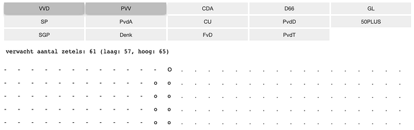
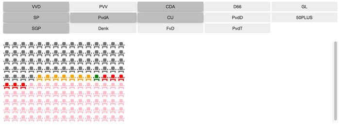
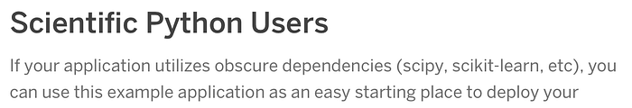

## Build interactive web apps with polling data, Voilà &amp; Heroku

Some time ago, [I wrote about how the popular Dutch political compass site Kieskompas works](/posts/2019-05-23---democracy/), just before the Dutch provincial elections.

Now, with the general elections coming up in March, I like to ***obsessively*** keep my eyes on the polls (although the past week I’ve mostly been obsessing over US election results, but I’ll return to Dutch politics next week, I guess). My usual source for these is [Peilingwijzer](https://peilingwijzer.tomlouwerse.nl/), which combines three of the biggest polls.

Looking at the party numbers is interesting and all. However, as a civilized democracy (political jab intended), the Netherlands has a many-party system where coalitions must be formed to gain a majority in parliament. We vote for one party, but after that the actual fun starts.


The seats widget we built for Coalitiewijzer, showing a possible majority coalition with “error seats” around it.

So, what everybody is actually interested in is to see whether their favorite (or most hated) coalition has any chance.

And since manually adding up party combinations is a boring chore that ***sucks all the joy out of*** forming coalitions and hence ***democracy as a whole***, why don’t we see if we can whip up an app for that?

In this post, I’ll show you how to do that really quickly in four steps:

1. Load the data with Pandas
2. Build an interactive visualization in a Jupyter notebook with **widgets**
3. Convert the notebook to a dashboard/GUI with **Voilà**
4. Deploy on **Heroku**

For the impatient: [the Coalitiewijzer app is live here for you to play with](https://coalitiewijzer.herokuapp.com/). Enjoy! You can also find all [the code on GitHub](https://github.com/egpbos/coalitiewijzer).

For those interested in details, read on.

## Data

Tom Louwerse, professor in political science at Leiden University, regularly publishes his aggregations of three of the biggest polls.

He uses a model that incorporates all past polls of each poller. Among other things, this corrects for “house effects”: the fact that a poller may have some bias towards one or the other party.

The model then combines all polls and produces a *best estimate* number of seats for each party, but also a **lower and upper value**. These give some indication of the **uncertainty** that is inherent in polls due to small sample size compared to the entire population of voters. The [method is described extensively on his website](https://peilingwijzer.tomlouwerse.nl/p/methode.html) and the [code can be found on GitHub](https://github.com/louwerse/peilingwijzer).

Unfortunately, one of the biggest polls, that of [Peil.nl](http://peil.nl/), is missing, because of some [legal issues](https://peilingwijzer.tomlouwerse.nl/2019/05/het-gebruik-van-de-peilingen-van-peilnl.html). Oh well.

So, let’s get our hands dirty. The data can be found in Excel format on the website under the Download tab. Once downloaded, the numbers can be easily loaded in Pandas using:

```python
import pandas as pd
numbers = pd.read_excel('Cijfers_Peilingwijzer.xlsx', header=0, index_col=0)
```

You need the `xlrd` Python package installed in your environment for this to work; this enables Excel support in Pandas. For reasons I don’t understand, and cannot seem to reliably reproduce, this sometimes fails. In that case, adding the `engine=”openpyxl”` argument sometimes helps (install the `openpyxl` package first).

Now (with `matplotlib` installed as well), we can quickly check whether the data was properly loaded by recreating the plot on the Peilingwijzer front page:

```python
# use only the seats ("zetels" in Dutch) numbers:
zetels = numbers.drop(columns=['Datum', 'Percentage', 'PercentageLaag', 'PercentageHoog'])
# we'll be making a stacked bar plot, so we need differences:
zetels['ZetelsHoog'] = zetels['ZetelsHoog'] - zetels['Zetels']
zetels['Zetels'] = zetels['Zetels'] - zetels['ZetelsLaag']
# reorder columns for proper stacking:
zetels = zetels.reindex(['ZetelsLaag', 'Zetels', 'ZetelsHoog'], axis=1)
# and plot!
zetels.plot.bar(stacked=True, figsize=(11, 8))
```

This gives us something like this:


Great, sanity checked. On to bigger things.

## Jupyter widgets

We can add interactive elements to our notebooks using [ipywidgets](https://ipywidgets.readthedocs.io/en/latest/). This package provides many standard web elements like buttons, checkboxes, sliders, file and date pickers, etcetera. These can then be tied together in different ways, so that one widget influences the others. All of this is explained really well in the [docs](https://ipywidgets.readthedocs.io/en/latest/examples/Widget%20Basics.html).

In our case, we want ***buttons*** for each of the parties and clicking them should ***update*** the total number of coalition seats in some kind of ***visualization***.

Let’s start with one `ToggleButton` for each party, which has an associated boolean value of either `True` or `False`:

```python
import ipywidgets as w

buttons = {party: w.ToggleButton(
                    description=party,
                    value=False,
                    layout=w.Layout(height='auto', width='auto')
                  )
           for party in numbers.index}
```

We immediately add a [layout](https://ipywidgets.readthedocs.io/en/latest/examples/Widget%20Styling.html#The-layout-attribute); the `Layout` object exposes CSS attributes. Why do we need this? When we would display this dictionary of buttons in the notebook without the layout, they would simply be displayed one after the other with some default size. We want them to be arranged a bit more tidily, so we will put them in a grid using `GridspecLayout`. Then the `auto` width and height set above will automatically resize the buttons with the grid.

```python
grid_width = 5
# scale the height so that we always have a big enough grid:
grid_height = (len(numbers) - 1) // grid_width + 1
grid = w.GridspecLayout(grid_height, grid_width)
# assign the buttons to the grid cells:
for ix, (key, button) in enumerate(buttons.items()):
    ix1, ix2 = ix // grid_width, ix % grid_width
    grid[ix1, ix2] = button
```

Now we can display the buttons from the notebook with `display(grid)`, which looks something like this:


Yes, we have only 14 parties in our parliament of 150 seats. I’m as disappointed as you, dear reader, that we don’t have 150 parties (yet!), but at least it’s more than many other countries have. Moving on!

The reason for putting the buttons in a dictionary, earlier, is that they can now be fed straight to the `interact` system. Using `widgets.interactive_output` we can couple a function to our `buttons` and every time any of the buttons is clicked, it calls the provided function and passes the widgets as arguments to that function.

```python
def on_toggle(**toggles):
    # do stuff with the button boolean values, par exemple:
    if toggles["VVD"]:
        print(f"VVD has {numbers.Zetels['VVD']} seats")

interact_out = widgets.interactive_output(on_toggle, buttons)
display(grid, interact_out)
```

Ok, it’s not really a visualization yet, but we’re getting there!

From the `on_toggle` function, you can manipulate any other widget that you have. We could, for instance, use a [progress bar](https://ipywidgets.readthedocs.io/en/latest/examples/Widget%20List.html#IntProgress) to show the total number of seats or even manipulate an [interactive plot](https://ipywidgets.readthedocs.io/en/latest/examples/Using%20Interact.html#Flickering-and-jumping-output).

My first attempt at actual visualization was to make another grid, but this time consisting of 150 HTML widgets, one for each seat. Then we can adjust `on_toggle` to modify the `value` attribute of each HTML widget, which is the character it displays. This gives us a poor man’s ASCII based seats visualization (see the [explore_things notebook on GitHub](https://github.com/egpbos/coalitiewijzer/blob/main/explore_things.ipynb) for the code). I was already pretty happy at this point…



### Fancy Vuetify widgets

However, to make sure I wasn’t reinventing the wheel in the form of a square block of granite, I asked [Maarten Breddels], who is strongly involved in ipywidgets development, whether he knew of any existing options in the landscape of available widgets.

He helped me set up a really fancy seats widget using [ipyvuetify](https://ipyvuetify.readthedocs.io/), an alternative widget library built by [Mario Buikhuizen] on top of ipywidgets using the [Vuetify](https://vuetifyjs.com/en/) Javascript UI library, a Vue library.

I won’t go into Vue here, because I don’t know much about it myself, except that it is a web framework like React. Apparently, though, it is not that hard to write Vue template based widgets. Vue templates have their own programming syntax with for-loops, conditionals and other useful stuff. What Maarten then came up with was something like this:

```python
from ipyvuetify import VuetifyTemplate
import traitlets

class PartyWidget(VuetifyTemplate):
    rows = traitlets.Int(10).tag(sync=True)
    cols = traitlets.Int(15).tag(sync=True)
    low = traitlets.Int(0).tag(sync=True)
    exp = traitlets.Int(0).tag(sync=True)
    high = traitlets.Int(0).tag(sync=True)
    template = traitlets.Unicode('''
<template>
  <div>
  <table>
  <tr v-for="i in rows">
    <td v-for="j in cols">
    <div>
      <v-icon v-if="(j + i * cols) < low">mdi-seat</v-icon>
      <v-icon v-else-if="(j + i * cols) < exp"
              style="color: orange">mdi-seat</v-icon>
      <v-icon v-else-if="(j + i * cols) == exp" style="color: green">mdi-seat</v-icon>
      <v-icon v-else-if="(j + i * cols) < high" style="color: red">mdi-seat</v-icon>
      <v-icon v-else style="color: pink">mdi-seat</v-icon>
    </div>
    </td>
  </tr>
  </div>
</template>
''').tag(sync=True)

pw = PartyWidget()
```

Let’s break that down, looking at the bold-face parts especially. The first, Pythonic part of the class defines five `traitlets` properties which we’re going to use to interactively change things. We use 10 rows and 15 columns here, giving a total of 150 seats. We can use the three other numbers `low`, `exp` and `high` for showing the expected number of seats estimates and the lower and higher uncertainty region boundaries.

Then comes the Vue magic in some kind of generative dialect of HTML. We’re going to generate a table with rows and columns using the `v-for` attribute which automatically generates a bunch of them.

Then, inside the table cells, we use a bunch of fancy seat icons, `*mdi-seat*`, with if/else conditionals with the `v-if` and `v-else-if` attributes. The point here is that we want to create different looking seats to indicate the expected number of seats and the lower and upper boundaries. We can simply use CSS style attributes for this.

Finally, we create an instance of the class. With that in hand, we can now put our `on_toggle` function to better use by modifying the PartyWidget `pw`’s values on each trigger:

```python
def on_toggle(**toggles):
    pw.low  = int(numbers[list(toggles.values())].ZetelsLaag.sum())
    pw.exp  = int(numbers[list(toggles.values())].Zetels.sum())
    pw.high = int(numbers[list(toggles.values())].ZetelsHoog.sum())
```

And that’s it! Now when we `display(pw)` our fancy new widget and the button grid with `interact_out` as before, we get something like this:


Fancy McSchmancyton!

And what is even more amazing (as you can experience [in the actual live app](https://coalitiewijzer.herokuapp.com/)): the changing of CSS properties is animated! The colors smoothly change from one to the next when you click a button. The same goes for other properties like opacity and even rotation. All this comes for free with ipyvuetify (I guess with Vuetify itself as well).

## Voilà

So, now we have a fancy interactive addition visualizer. However, it is in a notebook, which I do not want to share with my non-data scientist friends.

Enter Voilà.

[Voilà](https://github.com/voila-dashboards/voila/) is essentially a Jupyter Notebook server, with one big difference: it *only displays the output*** of running all the cells. Converting from a notebook to an actual app is just a matter of one command:

```sh
voila your_notebook.ipynb
```

Just like with Jupyter notebook, this starts up a server and opens a webpage in your browser showing the output of cells, including the widgets you created (if you put `display` commands in).

An active Python kernel is still running secretly in the background, though. This means you can still use the interactive functionality you setup between the widgets. You just cannot touch the code anymore. And this is exactly what we want when deploying our widgets as a user-facing interactive app.

Since this Python kernel does all the magic of updating and connecting the widgets behind the scenes, unfortunately we cannot do without. I’m hoping one day there will be a static page output option, but I guess that basically requires a Python to Javascript or webassembly transpiler… [Could be lots of fun](/using-c-in-a-web-app-with-webassembly-efd78c08469), but we’re not there yet, I’m afraid.

## Deploying on Heroku

So, if we want to put this app on the web, we need a place to host the Voilà server. If you happen to run your own server, that’s great ([here’s the guide on how to setup Voilà to run from there](https://voila.readthedocs.io/en/stable/deploy.html#running-voila-on-a-private-server)). If you don’t, read on (or, again, read the Voilà guide itself, which is what I did).

Deploying on Heroku is a really easy way to get online apps going quickly and free of charge (with limits, of course), which makes it ideal for testing. There’s even an official [guide on how to deploy a Voilà server on Heroku](https://voila.readthedocs.io/en/stable/deploy.html#deployment-on-heroku). There’s just a few catches to be aware of.

First, it’s good to notice this [really weird piece of Heroku documentation](https://devcenter.heroku.com/articles/python-pip#scientific-python-users):


“obscure” :DOkay, fine, I can pickle the necessary Peilingwijzer data and only use Python standard library functionality, instead of Pandas, numpy, matplotlib and some other weird and arcane packages that I’m sure nobody except me uses. I put this [conversion process in this script](https://github.com/egpbos/coalitiewijzer/blob/main/update_numbers.py).

Second, I ran into [a weird error](https://stackoverflow.com/questions/62618948/heroku-voila-app-error-process-exited-with-status-1), which was already documented earlier by someone on Stack Overflow. The Heroku app, despite the straightforward setup procedure, would not immediately run. Luckily the [solution was found in another repo](https://github.com/voila-dashboards/voila-heroku).

So with those things in mind, after rewriting things to make use of as little scientific Python packages as possible putting the app on Heroku was a matter of following the steps in the [Voilà Heroku deployment guide](https://github.com/egpbos/coalitiewijzer/blob/main/update_numbers.py):

* [Login using the Heroku CLI](https://devcenter.heroku.com/articles/getting-started-with-python#set-up) on your machine
* Add a `runtime.txt` file to your project/repo directory containing only a line with the Python runtime, which I set to `python-3.9.0`.
* Add a `Procfile` file to the directory containing the following line: `web: voila --port=$PORT --no-browser --enable_nbextensions=True your_notebook.ipynb`.
* Commit these files, a requirements.txt file with Python dependencies and the notebook to a git repo, if you haven’t done so yet.
* Create a Heroku app and push your code to it:

```sh
heroku create [appname]
git push heroku master
```

[And then, just like that, you are live](https://coalitiewijzer.herokuapp.com/)! You can open the app in your browser using `heroku open`, or just click the link. If you omit the app name in the `heroku create` command, Heroku will randomly generate a name for you. The name can be important, since it determines your URL, which will be [appname].herokuapp.com. You can change it later on, though.

Note that when you want to use a different clone of your repo to update your existing app (e.g. when coding on different machines), you have to reconnect Heroku to your app. If you would just run `heroku create` again, it would create a new app. To connect the repo to the existing app, run

```sh
heroku git:remote -a [appname]
```

The `[appname]` is the part of the app’s URL in front of herokuapp.com. You can also find it by running `heroku apps` on your command line, which gives you a list of all your apps.

So, if you hadn’t done so already, check out the resulting Coalitiewijzer app at [https://coalitiewijzer.herokuapp.com/](https://coalitiewijzer.herokuapp.com/) and let me know what you think!

For those that don’t like discussing on Medium: [Reddit thread here](https://www.reddit.com/r/Python/comments/jrjegk/built_a_voila_webapp_from_jupyter_with_a_fancy/) and [Twitter here](https://twitter.com/eScienceCenter/status/1325755219142201350).

This was my first time putting ipywidgets, Voilà and Heroku to use and I was really pleasantly surprised with how smooth all of them work. If you’re used to working in Jupyter notebooks, it’s an actual breeze to break out your exploration or visualization or other fun nugget of knowledge into something non-developers can also make good use of.

It just so happens that this time I needed it to scratch a politics itch, but I can see this workflow being very useful for science communication as well. I’ll definitely be using it again. Let me know what you built with it!
