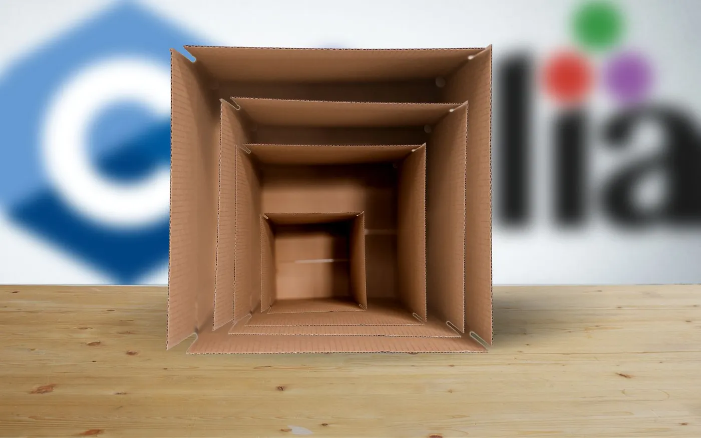
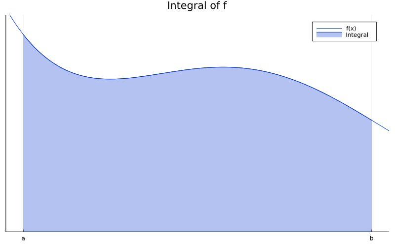
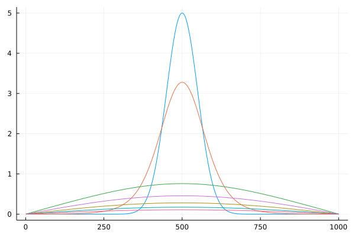

A beginner-friendly collection of examples



We can put C/C++ inside Julia, and Julia inside C/C++, but wait until we call C/C++ from Julia from C/C++. This image is derived from the photos of Andrej Lišakov and Kelli McClintock found on Unsplash.

I have been asked recently about how easy it would be to use Julia from inside C/C++. That was a very interesting question that I was eager to figure out. This question gave me the chance to explore a few toy problems, but I had some issues figuring out the basics. This post aims to help people in a similar situation. I don’t make any benchmarks or claims. Rather, I want to help kickstart future investigations.

The 10 examples in this post are more-or-less ordered by increasing difficulty. I explain some basic bits of Makefile, which can be skipped, if you know what you are doing.

Please notice that this was **not done in a production environment, and in no real projects**. Furthermore, I use Linux, which is also very specific. I also recommend you to check the code on [GitHub](https://github.com/abelsiqueira/julia-from-cpp), so you see the full result. If possible, leave a star, so I can use it as interest metric.

### Target audience

This post should be useful for people evaluating whether using Julia inside C/C++ will be a good idea, or are just very curious about it. I assume some knowledge of Julia and C/C++.

## Where is libjulia.so

First, install Julia and **remember where you are installing it**. I usually use [Jill](https://github.com/abelsiqueira/jill) — which is my bash script to install Julia — with the following commands:

Install Jill

In this case, `julia` will be installed in `/opt/julias/julia-x.y.z/` with a link to `/usr/local/bin/`.

You can try finding out where your Julia is installed using `which` to find the full path of `julia`, then listing with `-l` to check whether that is a link and where it points. For instance,

```sh
ls -l $(dirname $(which julia))/julia*
```

shows all relevant links.

Now, that folder, which I will call `JULIA_DIR`, should have folders `include` and `lib`, and therefore files `$JULIA_DIR/include/julia/julia/julia.h` and `$JULIA_DIR/lib/libjulia.so` should exist.

## The 10 examples

Now we start with the examples. Since we are using C/C++, I will start from 0, I guess. These examples are some of the files in the [GitHub](https://github.com/abelsiqueira/julia-from-cpp). Look for files sqrtX.cpp, integrationX.cpp, and linear-algebraX.cpp. Notice that there are more files than examples, because some are mostly repetition.

### 0: The basics

Let’s make sure that we can build and run a basic example, taken directly from the [official documentation](https://docs.julialang.org/en/v1/manual/embedding/):

```cpp
// Example from https://docs.julialang.org/en/v1/manual/embedding/
#include <julia.h>
JULIA_DEFINE_FAST_TLS // only define this once, in an executable (not in a shared library) if you want fast code.

int main(int argc, char *argv[])
{
    /* required: setup the Julia context */
    jl_init();

    /* run Julia commands */
    jl_eval_string("print(sqrt(2.0))");

    /* strongly recommended: notify Julia that the
         program is about to terminate. this allows
         Julia time to cleanup pending write requests
         and run all finalizers
    */
    jl_atexit_hook(0);
    return 0;
}
```

[File sqrt1.cpp](https://github.com/abelsiqueira/julia-from-cpp/blob/60abbe6eab216f6123d2af3008fb3c60f29470a3/sqrt1.cpp)

I hope the code comments are self-explanatory. To compile this code, let’s prepare a very simple `Makefile`.

Makefile (version 1)

Explaining:

- `-fPIC`: Position independent code. This is needed because we will work with shared libraries
- `-g`: Adding debug information because we will probably need it
- `JULIA_DIR`: It’s out Julia dir!
- `-I…`: Include path for `julia.h`
- `-L...`: Linking path for `libjulia.so`
- `-Wl,…`: Linking path for the linker
- `-ljulia`: `libjulia.so`
- `main.exe: main.cpp`: The file `main.exe` needs the file `main.cpp`
- On line 7 there must be a TAB, not spaces
- `$<`: Expands to the left-most requirement (`main.cpp`)
- `$@`: Expands to the target (`main.exe`)
- The Makefile expression as a whole: “To build a main.exe, look for `main.cpp` and run the command `g++ … main.cpp … -o main.exe` ”

Enter `make main.exe` in your terminal, and then `./main.exe`. Your output should be `1.4142135623730951`. I was not expecting this to just work, but it did. I hope you have a similar experience.

### 1: Expanding the basics

The simplest way to execute anything in Julia is to use `jl_eval_string`. Variables created using `jl_eval_string` remain in the Julia interpreter scope, so you can access them:

```cpp
jl_eval_string("x = sqrt(2.0)");
jl_eval_string("print(x)");
```

Returned values can be stored as pointers of type `jl_value_t`. To access their values, use `jl_unbox_SOMETYPE`. For instance:

```cpp
jl_value_t *x = jl_eval_string("sqrt(2.0)");
double x_value = jl_unbox_float64(x);
```

Finally, you can also store pointers to Julia functions using `jl_get_function`. The returned type is a pointer to a `jl_function_t` and we can’t just use it as a C++ function. Instead, we will use `jl_call1` and `jl_box_float64`.

```cpp
jl_function_t *sqrt = jl_get_function(jl_base_module, "sqrt");
jl_value_t *x = jl_call1(sqrt, jl_box_float64(2.0));
```

In the code above we have `jl_base_module`, which is everything in `Base` of Julia. The other common module is `jl_main_module`, which will include whatever we load (`using`) or create.

The function `jl_call1` is used to execute a Julia function with 1 argument. Variants with 0 to 3 arguments also exist, but if you need to call a function with more arguments, you need to use `jl_call`. We will get to that later.

In the end, we have something like this:

```cpp
#include <julia.h>
#include <iostream>
JULIA_DEFINE_FAST_TLS // only define this once, in an executable (not in a shared library) if you want fast code.

using namespace std;

int main() {
    jl_init();

    jl_function_t *sqrt = jl_get_function(jl_base_module, "sqrt");
    jl_value_t *x = jl_call1(sqrt, jl_box_float64(2.0));
    double xValue = jl_unbox_float64(x);
    cout << xValue << endl;

    jl_atexit_hook(0);
    return 0;
}
```

[File sqrt2.cpp](https://github.com/abelsiqueira/julia-from-cpp/blob/60abbe6eab216f6123d2af3008fb3c60f29470a3/sqrt2.cpp)

### 2: Exceptions

Now, try changing the 2.0 in the code above to -1.0. If you call `sqrt(-1.0)` in Julia you have a `DomainError`. But if you run the code with the change above, you will have a segmentation fault.

The problem is not in the execution, though, it is in the unboxing below of the now-undefined x. To check for exceptions on the Julia side we can use `jl_exception_occurred`. It returns the pointer to the error or 0 (NULL), so it can be used in a conditional statement.

To check the contents of `jl_exception_occurred`, we can use `showerror` from Julia’s Base.

After calling `sqrt` of -1.0, add the following:

```cpp
    if (jl_value_t *ex = jl_exception_occurred()) {
        jl_printf(jl_stderr_stream(), "Exception:\n");
        jl_call2(
            jl_get_function(jl_base_module, "showerror"),
            jl_stderr_obj(),
            ex
        );
        jl_printf(jl_stderr_stream(), "\nI quit!\n");
        jl_atexit_hook(1);
        exit(1);
    }
```

Treating exceptions

The first line creates a variable `ex` and assigns the exception to it. The evaluated expression is the value of `ex`, which will be either false if there is no exception, or true if something else was returned.

Then, we call `showerror` from Julia and pass to it Julia’s error stream with `jl_strerr_obj()`, and the exception. We add some flourish printing before and after the error message.

To call this a few times, we can create a function called `handle_julia_exception` wrapping it, and move it to auxiliary files (we’ll call them `aux.h` and `aux.cpp`). However, since we are printing, we would have to add `iostream` or `stdio` to our auxiliary files, and we don’t want that. Instead, what we can do is use `jl_printf` and `jl_stderr_stream` to print using only `julia.h`.

Therefore we can create the following files:

```cpp
#ifndef MY_JULIA_AUX
#define MY_JULIA_AUX

#include <julia.h>

void handle_julia_exception(void);
jl_value_t *handle_eval_string(const char* code);

#endif // MY_JULIA_AUX
```

[File aux.h](https://github.com/abelsiqueira/julia-from-cpp/blob/60abbe6eab216f6123d2af3008fb3c60f29470a3/aux.h)

```cpp
#include "aux.h"

void handle_julia_exception(void) {
    if (jl_value_t *ex = jl_exception_occurred()) {
        jl_printf(jl_stderr_stream(), "Exception:\n");
        jl_call2(
            jl_get_function(jl_base_module, "showerror"),
            jl_stderr_obj(),
            ex
        );
        jl_printf(jl_stderr_stream(), "\nI quit!\n");
        jl_atexit_hook(1);
        exit(1);
    }
}

jl_value_t *handle_eval_string(const char* code) {
    jl_value_t *result = jl_eval_string(code);
    handle_julia_exception();
    assert(result && "Missing return value but no exception occurred!");
    return result;
}
```

[File aux.cpp](https://github.com/abelsiqueira/julia-from-cpp/blob/60abbe6eab216f6123d2af3008fb3c60f29470a3/aux.cpp)

In our main file we can just add `#include "aux.h"` and call `handle_julia_exception()` directly. And since we are already here, we can also create a wrapper for `jl_eval_string` that checks for exceptions as well. Add the following to your auxiliary files:

```cpp
// To your aux.h
jl_value_t *handle_eval_string(const char* code);
```

and

```cpp
// To you aux.cpp
jl_value_t *handle_eval_string(const char* code) {
    jl_value_t *result = jl_eval_string(code);
    handle_julia_exception();
    assert(result && "Missing return value but no exception occurred!");
    return result;
}
```

And modify your Makefile accordingly:

```makefile
main.exe: main.cpp aux.o
	g++ $(CARGS) $< $(JLARGS) aux.o -o $@
%.o: %.cpp
	g++ $(CARGS) -c $< $(JLARGS) -o $@
```

The % in the Makefile acts as a wildcard.

After running the newest version, you should see something like:

```text
Exception:
DomainError with -1.0:
sqrt will only return a complex result if called with a complex argument. Try sqrt(Complex(x)).
I quit!
```

Other possibilities to handle exceptions and `JL_TRY` and `JL_CATCH` but I don’t have an example for it yet.

If you think that example would be useful, leave a comment.

### 3: Including Julia files and callings functions with 4 arguments or more

Let’s move on to something a little more convoluted, the trapezoid method for computing approximations for integrals.



Animation of Trapezoid approximation to the integral of a function.

The idea of the method is to approximate the integral of the function — the blue-shaded region — by a finite amount of trapezoid areas (caveat: the geometric interpretation only applies to positive functions). As the animation suggests, by increasing the number of trapezoids, we tend to get better approximations for the integral.

The neat formula for the approximation is


Trapezoid formula. LaTeX: \int_a^b f(x) \text{d}x \approx \frac{(b — a)}{2n}\left(f(a) + 2 \sum_{i = 1}^{n — 1} f(x_i) + f(b)\right)

A basic implementation of the trapezoid method in Julia is as follows:

```julia
function trapezoid(f, a, b, n)
    I = f(a) + f(b)
    for x in range(a, b, length=n+1)[2:end-1]
        I += 2 * f(x)
    end
    return I * (b - a) / 2n
end
```

[Snippet of aux.jl](https://github.com/abelsiqueira/julia-from-cpp/blob/60abbe6eab216f6123d2af3008fb3c60f29470a3/aux.jl)

Don’t worry, we are not allocating when using `range`, not even when accessing `[2:end-1]`.

Write down this to an `aux.jl` file and include this file using the code below:

```cpp
handle_eval_string("include(\"aux.jl\")");
```

Now we can access `trapezoid` as any other Julia code, for instance, using `jl_eval_string` or `jl_get_function`. It is important to notice that `trapezoid` is not part of the Base module. Instead, we must use the Main module through `jl_main_module`.

To test this function, let’s compute the integral of `x^2` from 0 to 1. We will use the evaluator to compute `x -> x^2`, which is the notation for anonymous functions in Julia. The result should be `1/3`.

```cpp
#include "aux.h"
#include <julia.h>
#include <iostream>
JULIA_DEFINE_FAST_TLS // only define this once, in an executable (not in a shared library) if you want fast code.

using namespace std;

int main() {
    jl_init();

    handle_eval_string("include(\"aux.jl\")");
    jl_function_t *trapezoid = jl_get_function(jl_main_module, "trapezoid");
    handle_julia_exception();
    jl_function_t *foo = handle_eval_string("x -> x^2");

    jl_value_t *args[4] = { foo, jl_box_float64(0.0), jl_box_float64(1.0), jl_box_int64(100) };
    jl_value_t *I = jl_call(trapezoid, args, 4);
    double IVal = jl_unbox_float64(I);
    cout << "Integral of x^2 is approx: " << IVal << endl;
    cout << "  Error: " << 1.0 / 3.0 - IVal << endl;

    jl_atexit_hook(0);
    return 0;
}
```

[File integration1.cpp](https://github.com/abelsiqueira/julia-from-cpp/blob/60abbe6eab216f6123d2af3008fb3c60f29470a3/integration1.cpp)

Notice that the function `x -> x^2` was created with a `handle_eval_string`, which calls `jl_eval_string`. The return value of `jl_eval_string` is a `jl_value_t *`, but surprise, a `jl_function_t` is actually just another name for `jl_value_t`. The difference is just for readability purposes.

The `trapezoid` function has 4 arguments, therefore we have to use the general `jl_call` that we mentioned before. The arguments of `jl_call` are the function, an array of `jl_value_t *` arguments, and the number of arguments.

### 4: C function from Julia from C

How about computing the integral of a C function? We will need to access it through Julia to be able to pass it to a Julia function. First, we must create the function in C. Create a file `my_c_func.cpp` with the following contents:

```cpp
#include <cmath>

extern "C" {
    double my_c_func(double x) {
        return x * x * x;
    }
}
```

It is important that we use `extern "C"` here, otherwise, C++ will [mangle the function name](https://en.wikipedia.org/wiki/Name_mangling). If you use C instead of C++, then this will not be an issue, but we intend to use C++ down the road. We will compile this code to a shared library, not only a `.o` object. Therefore, add the following to your Makefile:

```makefile
lib%.so: %.o
	ld -shared $< -o $@
```

`ld` is the linker and `-shared` is because we want a shared library. Furthermore, you should modify the following:

```makefile
main.exe: main.cpp aux.o libmy_c_func.so
```

Now, when you run `make main.exe`, the `libmy_c_func.so` library will be compiled.

Finally, to call this function, we use the same string evaluator and Julia’s `ccall`.

```cpp
    jl_function_t *foo = handle_eval_string(
        "x -> ccall((:my_c_func, \"libmy_c_func.so\"), Cdouble, (Cdouble,), x)"
    );
```

[Snippt of integration2.cpp](https://github.com/abelsiqueira/julia-from-cpp/blob/60abbe6eab216f6123d2af3008fb3c60f29470a3/integration2.cpp)

The `ccall` function has 4+ arguments:

* `(:my_c_func, "libmy_c_func.so")`: A tuple with the function name and the library;
* `Cdouble`: Return type;
* `(Cdouble,)`: Tuple with the types of the arguments;
* Then, all the arguments. In this case, only `x`.

That is it. This change is enough to make the code run. Notice that the function is `x^3`, so the integral result should be `1 / 4`. Those are the only differences in the code.

### 5: Using a package

Instead of implementing our own integration method, we can use some existing one. One option is [QuadGK.jl](https://github.com/JuliaMath/QuadGK.jl). To install it, open `julia`, press `]`, and enter `add QuadGK`.

An important note here is that I have not investigated much into maintaining a separate environment for these packages. If you know more about this subject, don’t hesitate to leave a comment.

Here is the code:

```cpp
handle_eval_string("using QuadGK");
jl_value_t *integrator = handle_eval_string(
    "(f, a, b, n) -> quadgk(f, a, b, maxevals=n)[1]"
);
```

Just like that we can compute the integral, and compare it with our implementation. Let’s use a harder integral to make things more interesting:


The integral of 1 over 1 plus x squared from 0 to 1 is Pi over 4. LaTeX: \int_0^1 \frac{1}{1 + x^2} \text{d}x = \frac{\pi}{4}.Here is the complete code for this example:

```cpp
#include "aux.h"
#include <julia.h>
#include <cmath>
#include <iostream>
JULIA_DEFINE_FAST_TLS // only define this once, in an executable (not in a shared library) if you want fast code.

using namespace std;

int main() {
    jl_init();

    handle_eval_string("include(\"aux.jl\")");
    jl_function_t *trapezoid = jl_get_function(jl_main_module, "trapezoid");
    handle_julia_exception();
    handle_eval_string("using QuadGK");
    jl_value_t *integrator = handle_eval_string("(f, a, b, n) -> quadgk(f, a, b, maxevals=n)[1]");
    handle_julia_exception();
    jl_function_t *foo = handle_eval_string("x -> 1 / (1 + x^2)");

    jl_value_t *args[4] = { foo, jl_box_float64(0.0), jl_box_float64(1.0), jl_box_int64(100) };
    jl_function_t *integrators[2] = { trapezoid, integrator };

    for (size_t i = 0; i < 2; i++) {
        jl_value_t *I1 = jl_call(integrators[i], args, 4);
        handle_julia_exception();
        double IVal = jl_unbox_float64(I1);
        cout << "Integral of 1 / (1 + x^2) is approx: " << IVal << endl;
        cout << "  Error: " << M_PI / 4 - IVal << endl;
    }

    jl_atexit_hook(0);
    return 0;
}
```

[File integration3.cpp](https://github.com/abelsiqueira/julia-from-cpp/blob/60abbe6eab216f6123d2af3008fb3c60f29470a3/integration3.cpp)

The results you should see are

```text
Integral of 1 / (1 + x^2) is approx: 0.785394
  Error: 4.16667e-06
Integral of 1 / (1 + x^2) is approx: 0.785398
  Error: -1.11022e-16
```

### 6: Using the Distributions package

The package Distributions contains various probability-related tools. We are going to use the Normal distributions’ PDF (Probability Density Function) and CDF (Cumulative Density Function) in this example. Don’t worry if you don’t know what these mean, we won’t need to understand the concept, only the formulas.

The Normal distribution with mean Mu (µ) and standard deviation Sigma (σ) has PDF given by


Normal probability density function. LaTeX: f(x) = \frac*{1}{\sigma*\sqrt*{2\pi}} e^{-*\frac*{1}{2}\left(*\frac*{x - \mu}{\sigma}\right)^2}And the CDF of a PDF is


Cumulative density function definition. LaTeX: F(x) = \int_{-\infty}^x f(t) \text{d}tWhat we will do is use the Distributions package to access the PDF and compute the CDF integral using QuadGK. We will then compare it to the existing CDF function in Distributions.

Once more there is not much secret. You only have to create the Normal structure on the Julia side and use Julia closures to define PDF and CDF `jl_function_t` with one argument. This is the code:

```cpp
handle_eval_string("normal = Normal()");
jl_function_t *pdf = handle_eval_string("x -> pdf(normal, x)");
jl_function_t *cdf = handle_eval_string("x -> cdf(normal, x)");
```

The full code is below

```cpp
#include "aux.h"
#include <julia.h>
#include <cmath>
#include <iostream>
#include <iomanip>
JULIA_DEFINE_FAST_TLS // only define this once, in an executable (not in a shared library) if you want fast code.

using namespace std;

int main() {
    jl_init();

    handle_julia_exception();
    handle_eval_string("using Distributions, QuadGK");
    jl_value_t *integrator = handle_eval_string("(f, a, b) -> quadgk(f, a, b)[1]");
    handle_julia_exception();

    handle_eval_string("normal = Normal()");
    jl_function_t *pdf = handle_eval_string("x -> pdf(normal, x)");
    jl_function_t *cdf = handle_eval_string("x -> cdf(normal, x)");

    for (double xVal = -4.0; xVal <= 4.0; xVal += 1.0) {
        jl_value_t *x = jl_box_float64(xVal);
        double pdfVal = jl_unbox_float64(jl_call1(pdf, x));
        double cdfVal = jl_unbox_float64(jl_call1(cdf, x));

        jl_value_t *I = jl_call3(integrator, pdf, jl_box_float64(-16.0), x);
        handle_julia_exception();
        double IVal = jl_unbox_float64(I);
        cout << std::scientific << std::setprecision(2) << std::showpos
             << "x: " << xVal
             << "  pdf: " << pdfVal
             << "  cdf: " << cdfVal
             << "  cdf - integral: " << cdfVal - IVal << endl;
    }

    jl_atexit_hook(0);
    return 0;
}
```

[File integration4.cpp](https://github.com/abelsiqueira/julia-from-cpp/blob/60abbe6eab216f6123d2af3008fb3c60f29470a3/integration4.cpp)

### 7: Creating a class to wrap the Distributions package

To complicate it a little bit more, let’s create a class wrapping the Distributions package. The basic idea will be a constructor to call `Normal` , and C++ functions wrapping `pdf` and `cdf`. This can be done simply by having a call to `handle_eval_string` or by creating the function with `jl_get_function` and calling `jl_call_X`.

However, to make it more efficient, we want to avoid frequent calls to the functions that deal with strings. One solution is to store the functions returned by `jl_get_function` and just use them when necessary. To do that, we will use `static` members in C++.

The two files below show the implementation of our class:

```cpp
#ifndef NORMAL_H
#define NORMAL_H

#include "aux.h" // includes julia.h

class Normal {
    private:
        jl_value_t *normal;
        double mean, standard_deviation;
        static bool distributions_loaded;
        static jl_function_t *_Normal, *_pdf, *_cdf;
    public:
        Normal(double mean = 0.0, double standard_deviation = 1.0);
        ~Normal();

        static void initialize() {
            if (distributions_loaded)
                return;
            handle_eval_string("using Distributions");
            distributions_loaded = 1;
            _Normal = jl_get_function(jl_main_module, "Normal");
            _pdf = jl_get_function(jl_main_module, "pdf");
            _cdf = jl_get_function(jl_main_module, "cdf");
            handle_julia_exception();
        }

        double pdf(double x);
        double cdf(double x);
};

#endif
```

[File Normal.h](https://github.com/abelsiqueira/julia-from-cpp/blob/60abbe6eab216f6123d2af3008fb3c60f29470a3/Normal.h)

```cpp
#include "Normal.h"

bool Normal::distributions_loaded = false;
jl_function_t *Normal::_Normal = 0;
jl_function_t *Normal::_pdf = 0;
jl_function_t *Normal::_cdf = 0;

Normal::Normal(double mean, double standard_deviation) {
    Normal::initialize();
    this->normal = jl_call2(_Normal, jl_box_float64(mean), jl_box_float64(standard_deviation));
}

Normal::~Normal() {}

double Normal::pdf(double x) {
    return jl_unbox_float64(jl_call2(_pdf, this->normal, jl_box_float64(x)));
}

double Normal::cdf(double x) {
    return jl_unbox_float64(jl_call2(_cdf, this->normal, jl_box_float64(x)));
}
```

[File Normal.cpp](https://github.com/abelsiqueira/julia-from-cpp/blob/60abbe6eab216f6123d2af3008fb3c60f29470a3/Normal.cpp)

As you can see, we keep a `distributions_loaded` flag to let the constructor know that the static variables can be used. In the initialization function, we define the necessary functions. The actual implementation of the constructor and the PDF and CDF functions is straightforward.

We can use this new class in our main file easily:

```cpp
#include "Normal.h"
#include <julia.h>
#include <cmath>
#include <iostream>
#include <iomanip>
JULIA_DEFINE_FAST_TLS // only define this once, in an executable (not in a shared library) if you want fast code.

using namespace std;

int main() {
    jl_init();

    Normal normal(3.27, 1.3);
    for (double x = -4.0; x <= 4.0; x += 1.0) {
        cout << std::scientific << std::setprecision(2) << std::showpos
             << "x: " << x
             << "  pdf: " << normal.pdf(x)
             << "  cdf: " << normal.cdf(x) << endl;
    }

    jl_atexit_hook(0);
    return 0;
}
```

[File integration5.cpp](https://github.com/abelsiqueira/julia-from-cpp/blob/60abbe6eab216f6123d2af3008fb3c60f29470a3/integration5.cpp)

Don’t forget to update your Makefile by replacing `aux.o` by `aux.o Normal.o`, i.e., add `Normal.o` next to`aux.o`. The result of this execution is

```text
x: -4.00e+00  pdf: +4.97e-08  cdf: +1.12e-08
x: -3.00e+00  pdf: +2.73e-06  cdf: +7.07e-07
x: -2.00e+00  pdf: +8.29e-05  cdf: +2.52e-05
x: -1.00e+00  pdf: +1.39e-03  cdf: +5.11e-04
x: +0.00e+00  pdf: +1.30e-02  cdf: +5.95e-03
x: +1.00e+00  pdf: +6.68e-02  cdf: +4.04e-02
x: +2.00e+00  pdf: +1.90e-01  cdf: +1.64e-01
x: +3.00e+00  pdf: +3.00e-01  cdf: +4.18e-01
x: +4.00e+00  pdf: +2.62e-01  cdf: +7.13e-01
```

### 8: Linear algebra: Arrays, Vectors, and Matrices

Let’s start our linear algebra exploration with a matrix-vector multiplication and solving a linear system. We will define the following:


x is a vector of ones and A is a matrix with n in the diagonal, 1 below the diagonal and -1 above the diagonal. LaTeX: x = \begin{bmatrix} 1 \\ 1 \\ 1 \\ \vdots \\ 1 \end{bmatrix}, A = \begin{bmatrix} n &amp; -1 &amp; -1 &amp; \cdots &amp; -1 \\ 1 &amp; n &amp; -1 &amp; \cdots &amp; -1 \\ 1 &amp; 1 &amp; n &amp; \cdots &amp; -1 \\ \vdots &amp; \vdots &amp; \vdots &amp; \ddots &amp; \vdots \\ 1 &amp; 1 &amp; 1 &amp; \cdots &amp; n \end{bmatrix}Let’s start with some code:

```cpp
    jl_value_t *array_type = jl_apply_array_type((jl_value_t *)
    jl_float64_type, 1);
    jl_value_t *matrix_type = jl_apply_array_type((jl_value_t *) jl_float64_type, 2);
    jl_array_t *x = jl_alloc_array_1d(array_type, n);
    jl_array_t *A = jl_alloc_array_2d(matrix_type, n, n);
    jl_array_t *y = jl_alloc_array_1d(array_type, n);

    JL_GC_PUSH3(&x, &A, &y);

    double *xData = (double *) jl_array_data(x);
    double *AData = (double *) jl_array_data(A);
```

Snippet from linear-algebra1.cpp

The first two statements define the vectors and matrices types. Notice that we make explicit that the first has 1 dimension and the second has 2 dimensions.

The next 3 statements allocate the memory for the two vectors `x` and `y`, and the matrix `A`, using the array types we previously defined.

Finally, we have a `JL_GC_PUSH3`, which informs Julia’s Garbage Collector to not touch this memory. Naturally, we will have to pop these eventually.

Lastly, we declare C arrays pointing to the Julia data. You will notice that `AData` is a 1-dimensional array because Julia implements dense matrices as a linearized array by columns. That means that the element`(i,j)` will be at the linearized position `i + j * nrows` — using 0-based indexing.

To fill the values of the vector `x` and the matrix `A` , we can use the code below:

```cpp
    for (size_t i = 0; i < jl_array_len(x); i++) {
        xData[i] = 1.0;
    }

    for (size_t i = 0; i < n; i++) {
        for (size_t j = 0; j < i; j++)
            AData[i + j * n] = 1.0;
        AData[i + i * n] = n;
        for (size_t j = i + 1; j < n; j++)
            AData[i + j * n] = -1.0;
    }
```

Snippet from linear-algebra1.cpp

The product of `A` and `x` is pretty much the same as any function we had so far.

```cpp
    handle_eval_string("using LinearAlgebra");
    jl_function_t *prod = jl_get_function(jl_base_module, "*");
    jl_array_t *Ax = (jl_array_t *) jl_call2(prod, (jl_value_t *) A, (jl_value_t *) x);

    double *AxData = (double *) jl_array_data(Ax);
    cout << "Ax =";
    for (size_t i = 0; i < n; i++) {
        cout << " " << AxData[i];
    }
    cout << endl;
```

Snippet from linear-algebra1.cpp

The noteworthy part of this code is that we have to cast the arrays for `jl_value_t *` to use them as arguments to `jl_call2` , and the output is cast to `jl_array_t *`. Similarly, we can use `jl_array_data(Ax)` to access the content of the product.

We can also use `mul!` to compute the product in place, i.e., without allocating more memory:

```cpp
    for (size_t i = 0; i < n; i++) {
        xData[i] = i + 1;
    }
    prod = jl_get_function(jl_main_module, "mul!");
    jl_call3(prod, (jl_value_t *) Ax, (jl_value_t *) A, (jl_value_t *) x);
    cout << "Ax =";
    for (size_t i = 0; i < n; i++) {
        cout << " " << AxData[i];
    }
    cout << endl;
```

Snippet from linear-algebra1.cpp

Notice that we use `jl_main_module` because `mul!` is part of `LinearAlgebra` .

Finally, we move on to solving the linear system. To do that, let’s use the [LU factorization](https://en.wikipedia.org/wiki/LU_decomposition) and the `ldiv!` function. The `\` [(backslash) operator](https://docs.julialang.org/en/v1/stdlib/LinearAlgebra/#Base.:\\-Tuple{AbstractMatrix,%20AbstractVecOrMat}) is usually used here, but we choose `ldiv!` to solve the linear system in place.

```cpp
jl_function_t *lu_fact = jl_get_function(jl_main_module, "lu");
jl_value_t *LU = jl_call1(lu_fact, (jl_value_t *) A);
jl_function_t *ldiv = jl_get_function(jl_main_module, "ldiv!");
jl_call3(ldiv, (jl_value_t *) y, LU, (jl_value_t *) Ax);
```

The last call defines `y` as the solution of the linear system `Ay = (Ax)` . Since `A` is non-singular, we expect `y` and `x` to be sufficiently close (numerical errors could appear here). We can verify this using

```cpp
double *yData = (double *) jl_array_data(y);
double norm2 = 0.0;
for (size_t i = 0; i < n; i++) {
    double dif = yData[i] - xData[i];
    norm2 += dif * dif;
}
cout << "|x - y|² = " << norm2 << endl;
```

My result was `6.48394e-26` .

To finalize this code, we have to run

```cpp
JL_GC_POP();
```

This allows the Julia Garbage Collector to collect the allocated memory. The complete code can be seen below:

```cpp
#include "aux.h"
#include <iostream>
#include <julia.h>

JULIA_DEFINE_FAST_TLS // only define this once, in an executable

using namespace std;

int main() {
    int n = 100;

    jl_init();

    jl_value_t *array_type = jl_apply_array_type((jl_value_t *)
    jl_float64_type, 1);
    jl_value_t *matrix_type = jl_apply_array_type((jl_value_t *) jl_float64_type, 2);
    jl_array_t *x = jl_alloc_array_1d(array_type, n);
    jl_array_t *A = jl_alloc_array_2d(matrix_type, n, n);
    jl_array_t *y = jl_alloc_array_1d(array_type, n);

    JL_GC_PUSH3(&x, &A, &y);

    double *xData = (double *) jl_array_data(x);
    double *AData = (double *) jl_array_data(A);

    for (size_t i = 0; i < jl_array_len(x); i++) {
        xData[i] = 1.0;
    }

    for (size_t i = 0; i < n; i++) {
        for (size_t j = 0; j < i; j++)
            AData[i + j * n] = 1.0;
        AData[i + i * n] = n;
        for (size_t j = i + 1; j < n; j++)
            AData[i + j * n] = -1.0;
    }

    handle_eval_string("using LinearAlgebra");
    jl_function_t *prod = jl_get_function(jl_base_module, "*");
    jl_array_t *Ax = (jl_array_t *) jl_call2(prod, (jl_value_t *) A, (jl_value_t *) x);

    double *AxData = (double *) jl_array_data(Ax);
    cout << "Ax =";
    for (size_t i = 0; i < n; i++) {
        cout << " " << AxData[i];
    }
    cout << endl;

    for (size_t i = 0; i < n; i++) {
        xData[i] = i + 1;
    }
    prod = jl_get_function(jl_main_module, "mul!");
    jl_call3(prod, (jl_value_t *) Ax, (jl_value_t *) A, (jl_value_t *) x);
    cout << "Ax =";
    for (size_t i = 0; i < n; i++) {
        cout << " " << AxData[i];
    }
    cout << endl;

    jl_function_t *lu_fact = jl_get_function(jl_main_module, "lu");
    handle_julia_exception();
    jl_value_t *LU = jl_call1(lu_fact, (jl_value_t *) A);
    handle_julia_exception();
    jl_function_t *ldiv = jl_get_function(jl_main_module, "ldiv!");
    jl_call3(ldiv, (jl_value_t *) y, LU, (jl_value_t *) Ax); // Solve y = A \ (Ax)
    handle_julia_exception();

    double *yData = (double *) jl_array_data(y);
    double norm2 = 0.0;
    for (size_t i = 0; i < n; i++) {
        double dif = yData[i] - xData[i];
        norm2 += dif * dif;
    }
    cout << "|x - y|² = " << norm2 << endl;

    JL_GC_POP();

    handle_julia_exception();

    jl_atexit_hook(0);

    return 0;
}
```

[File linear-algebra1.cpp](https://github.com/abelsiqueira/julia-from-cpp/blob/60abbe6eab216f6123d2af3008fb3c60f29470a3/linear-algebra1.cpp)

### 9: Sparse matrices

For our next example, we will solve a heat-equation on 1 spatial dimension, using a discretization of time and space called Backward Time Centered Space (BTCS), which is not quick to explain. Check [these notes](https://john-s-butler-dit.github.io/NumericalAnalysisBook/Chapter%2008%20-%20Heat%20Equations/802_Heat%20Equation-%20BTCS.html#the-implicit-backward-time-centered-space-btcs-difference-equation) for a thorough explanation.

For our interests, it suffices to say that we will be solving a sparse linear system multiple times, where the matrix is the one below:


Tridiagonal matrix, where the diagonal stores 1 plus 2 times kappa, and the off-diagonal values are -kappa. LaTeX: A = \begin{bmatrix} 1 + 2\kappa &amp; -\kappa \\ -\kappa &amp; 1 + 2\kappa &amp; \kappa \\ &amp; \ddots &amp; \ddots &amp; \ddots \\ &amp; &amp; -\kappa &amp; 1 + 2\kappa &amp; -\kappa \\ &amp; &amp; &amp; -\kappa &amp; 1 + 2\kappa \end{bmatrix}We don’t have to store this matrix as a dense matrix (like in the previous example). Instead, we want to store only the relevant elements. To do that, we will create three vectors for the rows and columns indexes, and for the values corresponding to these indexes.

The code is below:

```cpp
long int rows[3 * n - 2], cols[3 * n - 2];
double vals[3 * n - 2];
for (size_t i = 0; i < n; i++) {
    rows[i] = i + 1;
    cols[i] = i + 1;
    vals[i] = (1 + 2 * kappa);
    if (i < n - 1) {
        rows[n + i] = i + 1;
        cols[n + i] = i + 2;
        vals[n + i] = -kappa;
        rows[2 * n + i - 1] = i + 2;
        cols[2 * n + i - 1] = i + 1;
        vals[2 * n + i - 1] = -kappa;
    }
}
```

Now, we will create a sparse matrix using the `sparse` function from the `SparseArrays` module in Julia. For that, we allocate two array types, one for the integers, and one for the floating point numbers.

```cpp
    jl_value_t *array_type = jl_apply_array_type((jl_value_t *) jl_float64_type, 1);
    jl_value_t *array_index_type = jl_apply_array_type((jl_value_t *) jl_int64_type, 1);
    jl_function_t *sparse = jl_get_function(jl_main_module, "sparse");
    handle_julia_exception();

    jl_value_t *A_sparse = jl_call3(
        sparse,
        (jl_value_t *) jl_ptr_to_array_1d(array_index_type, rows, 3 * n - 2, 0),
        (jl_value_t *) jl_ptr_to_array_1d(array_index_type, cols, 3 * n - 2, 0),
        (jl_value_t *) jl_ptr_to_array_1d(array_type, vals, 3 * n - 2, 0)
    );
```

Snippet from linear-algebra3.cpp

On the `jl_call3` , we also call `jl_ptr_to_array_1d` to directly create and return a Julia vector wrapping the data we give it.

The `A_sparse`matrix is a Julia sparse matrix. Many of the matrix operations that work with dense matrices will work with sparse matrices. To test a different factorization, let’s use the function `ldl` from the `LDLFactorizations` package.

```cpp
    jl_function_t *ldl = jl_get_function(jl_main_module, "ldl");
    jl_function_t *ldiv = jl_get_function(jl_main_module, "ldiv!");

    handle_eval_string("plot()");
    jl_call1(plot, (jl_value_t *) u);
    handle_julia_exception();

    jl_value_t *ldlObj = jl_call1(ldl, (jl_value_t *) A_sparse);
```

Snippet from linear-algebra3.cpp

Now, we can use `ldiv!` with `ldlObj` instead of the LU factorization that we used in the previous example. There is one catch, though. Since we are using the `ldlObj` “for a while”, we need to prevent the Garbage collector to clean it. But the `JL_GC_PUSHX` function can only be called once per scope. Therefore, to use it we have to create an internal scope. So something like the following:

```cpp
    jl_value_t *ldlObj = jl_call1(ldl, (jl_value_t *) A_sparse);
    {
        JL_GC_PUSH1(&ldlObj);
        handle_julia_exception();

        size_t time_interval = NT / 5;
        for (size_t k = 0; k < NT; k++) {
            jl_call3(ldiv, (jl_value_t *) unew, ldlObj, (jl_value_t *) u);
            handle_julia_exception();
            if (k % time_interval == 0 || k == NT - 1) {
                jl_call1(plot, (jl_value_t *) unew);
                handle_julia_exception();
            }
            for (size_t i = 0; i < n; i++)
                uData[i] = unewData[i];
        }
        JL_GC_POP();
    }
```

Scope your second JL_GC_PUSH

The complete code is below:

```cpp
#include "aux.h"
#include <iostream>
#include <julia.h>

JULIA_DEFINE_FAST_TLS // only define this once, in an executable

using namespace std;

double starting_value(double x) {
    return 5 * exp(-50 * x * x);
}

int main() {
    int n = 1000;
    double NT = 100;
    double a = -1.0, b = 1.0;
    double u_a = 0.0, u_b = 1.0;
    double h = (b - a) / n;
    double delta = 0.01;
    double kappa = delta / h / h;

    long int rows[3 * n - 2], cols[3 * n - 2];
    double vals[3 * n - 2];

    for (size_t i = 0; i < n; i++) {
        rows[i] = i + 1;
        cols[i] = i + 1;
        vals[i] = (1 + 2 * kappa);
        if (i < n - 1) {
            rows[n + i] = i + 1;
            cols[n + i] = i + 2;
            vals[n + i] = -kappa;
            rows[2 * n + i - 1] = i + 2;
            cols[2 * n + i - 1] = i + 1;
            vals[2 * n + i - 1] = -kappa;
        }
    }

    jl_init();

    handle_eval_string("using LDLFactorizations, SparseArrays, Plots");

    jl_value_t *array_type = jl_apply_array_type((jl_value_t *) jl_float64_type, 1);
    jl_value_t *array_index_type = jl_apply_array_type((jl_value_t *) jl_int64_type, 1);
    jl_function_t *sparse = jl_get_function(jl_main_module, "sparse");
    handle_julia_exception();

    jl_value_t *A_sparse = jl_call3(
        sparse,
        (jl_value_t *) jl_ptr_to_array_1d(array_index_type, rows, 3 * n - 2, 0),
        (jl_value_t *) jl_ptr_to_array_1d(array_index_type, cols, 3 * n - 2, 0),
        (jl_value_t *) jl_ptr_to_array_1d(array_type, vals, 3 * n - 2, 0)
    );
    jl_array_t *u = jl_alloc_array_1d(array_type, n);
    jl_array_t *unew = jl_alloc_array_1d(array_type, n);
    JL_GC_PUSH3(&u, &unew, &A_sparse);

    double *uData = (double *) jl_array_data(u);
    double *unewData = (double *) jl_array_data(unew);

    for (size_t i = 0; i < n; i++)
        uData[i] = starting_value(a + (i + 1) * h);

    jl_function_t *plot = handle_eval_string("(args...) -> plot!(args...; leg=false)");
    jl_function_t *ldl = jl_get_function(jl_main_module, "ldl");
    jl_function_t *ldiv = jl_get_function(jl_main_module, "ldiv!");

    handle_eval_string("plot()");
    jl_call1(plot, (jl_value_t *) u);
    handle_julia_exception();

    jl_value_t *ldlObj = jl_call1(ldl, (jl_value_t *) A_sparse);
    {
        JL_GC_PUSH1(&ldlObj);
        handle_julia_exception();

        size_t time_interval = NT / 5;
        for (size_t k = 0; k < NT; k++) {
            jl_call3(ldiv, (jl_value_t *) unew, ldlObj, (jl_value_t *) u);
            handle_julia_exception();
            if (k % time_interval == 0 || k == NT - 1) {
                jl_call1(plot, (jl_value_t *) unew);
                handle_julia_exception();
            }
            for (size_t i = 0; i < n; i++)
                uData[i] = unewData[i];
        }
        JL_GC_POP();
    }

    handle_eval_string("png(\"linear-algebra3\")");

    JL_GC_POP();

    handle_julia_exception();

    jl_atexit_hook(0);

    return 0;
}
```

[File linear-algebra3.cpp](https://github.com/abelsiqueira/julia-from-cpp/blob/60abbe6eab216f6123d2af3008fb3c60f29470a3/linear-algebra3.cpp)

In the algorithm, we define `u` as the initial vector, then solve the linear system right `u` as the right-hand side to obtain `unew`. Then we assign `unew` to `u` and repeat. Each `u` is an approximation to the solution of the heat equation for a specific moment in time.

You will notice that, in addition to computing the solution, we also plot it using the `Plots` package. We plot the initial solution at different times. This makes the code much slower, unfortunately. The result can be seen below:


Plot of heat equation solution at different moments in time.

### Finalizing and open questions

I hope these 10 examples are helpful to get you started with embedding Julia in C. There are many more things not covered here, in particular things I do not know. Some of them are:

* How to deal with strings?
* How to deal with keyword arguments?
* How to deal with installing packages and environments?
* How to make it faster (e.g., using precompiled images)?

I will be on the lookout for future projects to investigate these. In the meantime, like and follow for more Julia and C/C++ content.

### References and extra material

* [Embedding Julia in the Julia documentation](https://docs.julialang.org/en/v1/manual/embedding/)
* [Embedding Julia libraries in C++ by Matthijs Cox](https://forem.julialang.org/matthijscox/embedding-julia-libraries-in-c-1n12)
* [https://discourse.julialang.org/t/calling-jl-gc-push1-multiple-times/18666](https://discourse.julialang.org/t/calling-jl-gc-push1-multiple-times/18666)
