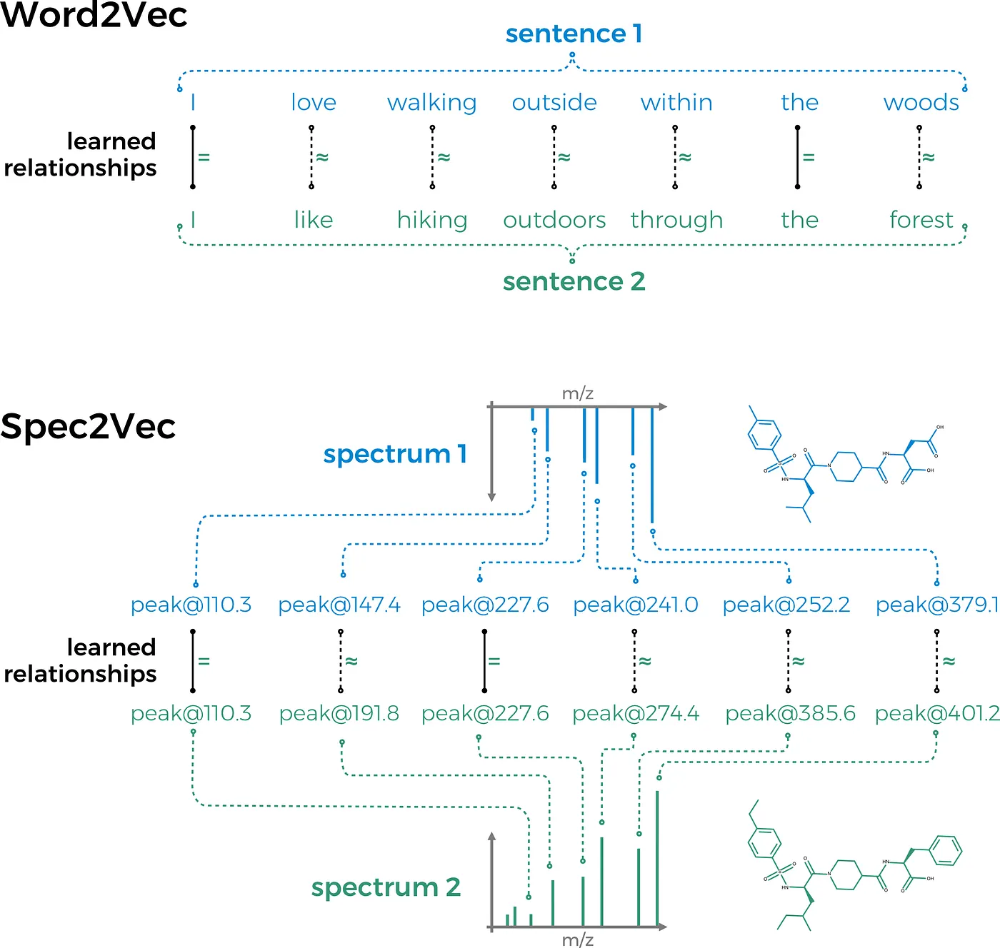

## After “part I” which gave an introduction on how to import, process, and analyze a tandem mass spectra dataset using Python and matchms, “part II” will add Spec2Vec to the game, a machine learning tool to assess spectrum similarities.

*[last edit: 31/01/2023, using spec2vec 0.8.0 and matchms 0.18.0]*

In [part I of this tutorial](/posts/2023-01-31---build-your-own-mass-spectrometry-analysis-pipeline-in-python/), [matchms](https://github.com/matchms/matchms), a Python library to import, process, and compare tandem mass spectrometry data was introduced. We imported a MS/MS dataset with spectra of natural products which we [downloaded from GNPS](https://gnps-external.ucsd.edu/gnpslibrary/GNPS-NIH-NATURALPRODUCTSLIBRARY.mgf). The data then was processed using matchms to gain more reliable metadata and remove possible noise peaks. This mainly included:

- metadata cleaning
- normalizing peak intensities
- removing small peaks (here simply: <0.01 of max peak intensity)

We will continue working with the data that we got after those processing steps and will then use it to compute spectrum similarities using Spec2Vec. So, to run the following code you would first have to run the processing from part I to continue here.

Let’s move to [**Spec2Vec**](https://journals.plos.org/ploscompbiol/article?id=10.1371%2Fjournal.pcbi.1008724) now! Spec2Vec is an unsupervised machine learning technique that can learn relationships between peaks from co-occurrences across large(r) MS/MS datasets. It is mainly based on the Word2Vec algorithm which is well known in the field of natural language processing.



Figure 1. Sketch of the main idea behind Spec2Vec. Similar to algorithms in natural language processing (mainly Word2Vec), relationships between spectrum peaks are learned from co-occurrences across large MS/MS datasets. Unlike classical spectrum similarity scores (Cosine etc.), Spec2Vec is hence able to take into account that peaks with different m/z values can still have a highly related “meaning” (reflected by having vectors with similar directions in an abstract vector space, called embeddings). Image: CC BY 4.0, Florian Huber.

Spec2Vec can be used in two fundamentally different ways.

**(1)** Loading a Spec2Vec model which was pretrained on a large MS/MS dataset.

**(2)** A Spec2Vec model can be trained on the dataset of interest itself. This requires a sufficiently large datasets (at least several hundreds of spectra).

We will do both things in the following part of this tutorial.

### Getting the required packages

If you have run part I before then you can simply add spec2vec by `pip install spec2vec`. Otherwise you can create a new environment by running the following:

```sh
conda create --name spec2vec python=3.8
conda activate spec2vec
conda install --channel bioconda --channel conda-forge matchms spec2vec
```

### Import the processed data from part I

If you did the data [importing and processing as shown in part I](/posts/2023-01-31---build-your-own-mass-spectrometry-analysis-pipeline-in-python/) then you can simply continue from there, e.g. by importing the data that was stored after the processing:

```python
import os
import numpy as np
from matchms.importing import load_from_json
path_data = os.path.join(os.path.dirname(os.getcwd()), "data") #"..." enter your pathname to the downloaded file
file_json = os.path.join(path_data, "GNPS-NIH-NATURALPRODUCTSLIBRARY_processed.json")
spectrums = list(load_from_json(file_json))
```

## 1. Load a pretrained Spec2Vec model

For many use-cases we would not advice to retrain a new model from scratch. Instead a more general model that has been trained on a large MS/MS dataset can simply be loaded and used to calculate similarities, even for spectra which were not part of the initial model training.

Here we can download a model trained on about 95,000 spectra from GNPS (positive ionmode) which [can be downloaded from Zenodo](https://zenodo.org/record/4173596).
Now let’s import this model.

```python
import gensim
path_model = os.path.join(os.path.dirname(os.getcwd()),
                          "data", "trained_models")
                           # enter your path name when different
filename_model = "spec2vec_AllPositive_ratio05_filtered_201101_iter_15.model"
filename = os.path.join(path_model, filename_model)
model = gensim.models.Word2Vec.load(filename)
```

It is very important to make sure that the “documents” are created the same way as for the model training. This mostly comes down here to the number of decimals which needs to be the same here than for the pretrained model. To inspect the words the model has learned, we can look at `model.wv` which is the "vocabulary" the model has learned. Let’s for instance see how a word looks like:

```python
model.wv.index_to_key[0]
```

This should give `peak@289.29`, which also tells us that the model was trained on words with 2 decimals (for `Spec2Vec < 0.5.0` you need to run `next(iter(model.wv.vocab)` instead).

### Calculate spectrum similarities

Now comes the fun part. With both spectrums and a trained model we can start computing Spec2Vec spectrum similarities. First, we will initialize Spec2Vec by running:

```python
from spec2vec import Spec2Vec
spec2vec_similarity = Spec2Vec(model=model,
                               intensity_weighting_power=0.5,
                               allowed_missing_percentage=5.0)
```

Apart from using the before loaded `model` we here set two parameters. The model itself will convert spectrum peaks (here: “words”) into abstract vectors (“embeddings”) which are then added up to give us a spectrum embedding. The parameter `intensity_weighting_power` defines by what power of its intensity we scale each word vector, usually we use `0.5`. The `allowed_missing_percentage` specifies what percentage of a spectrum is allowed to be unknown to the used model.

Let’s now compute some actual Spec2Vec spectrum similarities, for instance between for all possible pairs within our list of spectrums by running:

```python
from matchms import calculate_scores
scores = calculate_scores(spectrums, spectrums, spec2vec_similarity,
                          is_symmetric=True)
```

In the example given here we set `is_symmetric=True` to indicate that both inputs are the same (the calculation can then be a bit faster because score[i,j] = score[j,i]). In general, if you want to get Spec2Vec similarities between two different list of spectrums, you would have to run:

```python
scores = calculate_scores(spectrums1, spectrums2,
                          spec2vec_similarity)
```

You might notice a printed warning saying “ *Found 1 word(s) missing in the model. Weighted missing percentage not covered by the given model is 0.19%.”*. Don’t worry. This simply means that 1 word (=1 peak) that occurs in our `spectrums ` was not part of the loaded model. Depending on how important that peak is (its intensity) this could be a problem. However, here it only corresponds to a missing percentage for that particular spectrum of 0.19% which is far below the above set threshold of `allowed_missing_percentage=5.0`. If it would have been above the set threshold the run will fail in which case you either have to remove the respective spectra, retrain the model, or set the threshold to a higher value.

And the following will give you the best Spec2Vec scores for a particular spectrum (here as an example I used `spectrums[11]`).

```python
best_matches = scores.scores_by_query(spectrums[11], sort=True)[:10]
[x[1] for x in best_matches]
```

More interesting for most researchers might be [*SMILES*](https://en.wikipedia.org/wiki/Simplified_molecular-input_line-entry_system) of the best scoring spectra, which can be accessed in a similar way.

```python
[x[0].get("smiles") for x in best_matches]
```

The respective compounds can also be plotted, which we will also do later in the 2nd part of this section (with a new model trained from scratch).

Instead of looking at a few individual query spectra, lets have a look at the “bigger picture” by plotting part of the similarity score matrix we just computed to generate Figure 2**.

```python
from matplotlib import pyplot as plt
scores_array = scores.scores.to_array()  # for matchms >= 0.18.0
plt.figure(figsize=(6,6), dpi=150)
plt.imshow(scores_array[:50, :50], cmap="viridis")
plt.colorbar(shrink=0.7)
plt.title("Spec2Vec spectra similarities")
plt.xlabel("Spectrum #ID")
plt.ylabel("Spectrum #ID")
plt.clim(0, 1)  # Spec2Vec scores can be between -1 and 1
#plt.savefig("spec2vec_scores.png")
```

Figure 2**. Show the first 50 x 50 Spec2Vec similarity scores. The diagonal are scores between spectra and themselves, hence always = 1.0 (boring). But the few brighter (green/yellowish) dots here and there point out some apparently related spectra, according to Spec2Vec. Those might be worth a closer look.

## 2. Train a new Spec2Vec model from scratch

Training a Spec2Vec model is fairly straightforward and relatively fast (usually minutes to one hour max). In general, training a new model from scratch makes sense when a lot a data is present to train on as it gives more options to optimize the results when compared to simply using a pretrained model as done above.

First, the spectrum data has to be converted into “documents” where peaks and neutral losses have become “words” (e.g. `peak@289.29`). This can be done by running:

```python
from spec2vec import SpectrumDocument
spectrum_documents = [SpectrumDocument(s, n_decimals=2) for s in spectrums]
```

Then, a new model can simply be trained by using `train_new_word2vec_model`. The following code will create a new model which is trained for 25 iterations (for machine learning people: that is ”epochs”) on 2 workers (you can change this, e.g. to 4 if you have 4 cores, the difference is not drastic though). Depending on your hardware, the training of this model should not take longer than a couple of minutes.

```python
from spec2vec.model_building import train_new_word2vec_model
model_file = "tutorial_model.model"
model = train_new_word2vec_model(spectrum_documents, iterations=[25], filename=model_file,
                                 workers=2, progress_logger=True)
```

The above code snippet will automatically save the model under the name `tutorial_model.model`, which could later load again by running `model = gensim.models.Word2Vec.load("tutorial_model.model")`.

### Calculate spectrum similarities

Once we have our trained model we can again (as above with the pretrained model) compute spectrum similarities.

```python
from matchms import calculate_scores
from spec2vec import Spec2Vec
spec2vec_similarity = Spec2Vec(model=model, intensity_weighting_power=0.5,
                               allowed_missing_percentage=5.0)
scores = calculate_scores(spectrum_documents, spectrum_documents, spec2vec_similarity, is_symmetric=True)
```

Here again we can search for the best matching compounds according to Spec2Vec.

```python
best_matches = scores.scores_by_query(spectrum_documents[11], sort=True)[:10]
[x[0].get("smiles") for x in best_matches]
```

And we can plot the resulting smiles to .png files by running:

```python
from rdkit import Chem
from rdkit.Chem import Draw
for i, smiles in enumerate([x[0].get("smiles") for x in best_matches]):
    m = Chem.MolFromSmiles(smiles)
    Draw.MolToFile(m, f"compound_{i}.png")
```

The best 8 matches are plotted in Figure 3**.

**Figure 3.** Compounds of the highest 9 Spec2Vec similarity scores within the dataset with respect to spectrums[11], the first being the spectrum of interest itself (hence “query compound”).This example in figure 3 looks already quiet promising and all selected candidates clearly show chemical similarities! But this is of course just one mostly random pick out of many spectra. In our [Spec2Vec paper](https://www.biorxiv.org/content/10.1101/2020.08.11.245928v2) we compared the different similarity scores (Cosine, modified Cosine, Spec2Vec) in much more detail and found that Spec2Vec often — but not always — outperformed the classical scores. We also found a general trend that such scores are generally more reliable for larger compounds, supposedly because those will come with a higher number of chemically meaningful fragments.

**Figure 4.** Working with different datasets from GNPS we evaluated the quality of Spec2Vec based spectrum suggestions and found that they get better with increasing compound mass. Taken from [Spec2Vec article](https://journals.plos.org/ploscompbiol/article?id=10.1371%2Fjournal.pcbi.1008724).
> OK. Done for now. Really curious to see what you can get out of Spec2Vec!

## Other parts of this tutorial

### [part I — Build you own mass spectrometry pipeline](/build-your-own-mass-spectrometry-analysis-pipeline-in-python-using-matchms-part-i-d96c718c68ee)

### [part II — Compute spectra similarities using Spec2Vec](/build-a-mass-spectrometry-analysis-pipeline-in-python-using-matchms-part-ii-spec2vec-8aa639571018)

### [part III — Network analysis based on spectra similarities](/build-a-mass-spectrometry-analysis-pipeline-in-python-using-matchms-part-iii-molecular-91891248ee34)

## matchms library

**matchms*** is freely available and open-source. You can find the [code on Github](https://github.com/matchms/matchms), the package is available as [conda package](https://anaconda.org/nlesc/matchms) (recommended) or [from pypi](https://pypi.org/project/matchms/). It was developed by a bunch of very nice people (see [here](https://github.com/matchms/matchms/blob/master/CITATION.cff)) and is [published in Joss](https://joss.theoj.org/papers/10.21105/joss.02411).

## spec2vec library

**Spec2Vec** is of course also freely available and open-source. You can find the [code on Github](https://github.com/iomega/spec2vec), the package is available as [conda package](https://anaconda.org/nlesc/spec2vec) (recommended) or [from pypi](https://pypi.org/project/spec2vec/). The [article published in PLOS Computational Biology can be found here](https://journals.plos.org/ploscompbiol/article?id=10.1371%2Fjournal.pcbi.1008724).

You can find more information in the [matchms documentation](https://matchms.readthedocs.io/en/latest/) and the [spec2vec documentation](https://spec2vec.readthedocs.io/en/latest/?badge=latest).

## Code

The code shown in this blog post can also be found [as Jupyter notebook on GitHub](https://github.com/matchms/matchms/blob/tutorial/tutorial/matchms_tutorial_02_compute_similarities_with_Spec2Vec.ipynb).

## Help us develop matchms and spec2vec further!

We really hope that matchms will help people to build new, better analysis pipelines and that spec2vec can improve your analysis results. So, please help us to further improve matchms and spec2vec. You can help us by **(1)** Cite our work if you use our package for your research: [matchms article in JOSS,](https://joss.theoj.org/papers/10.21105/joss.02411) [spec2vec article in PLOS Computational Biology](https://journals.plos.org/ploscompbiol/article?id=10.1371%2Fjournal.pcbi.1008724).**(2)** Let us know if you run into any issues using matchms and/or spec2vec, or if you are missing any key functionalities! You can simply do so by starting a new issue on the [matchms GitHub repository,](https://github.com/matchms/matchms) or contact me on twitter [@me_datapoint](https://twitter.com/me_datapoint?lang=en).**You are of course more than welcome to also become an active contributor to the package and help extend its functionality!
(3)** Please let us know if you successfully applied matchms and/or spec2vec in your research project (makes us happy + we can maybe share the good news!).

Thanks a lot!

I would like to thank [Carlos Martinez-Ortiz], [Justin van der Hooft] and [Kontoueftychia] for helpful comments and suggestions on this blog post.
