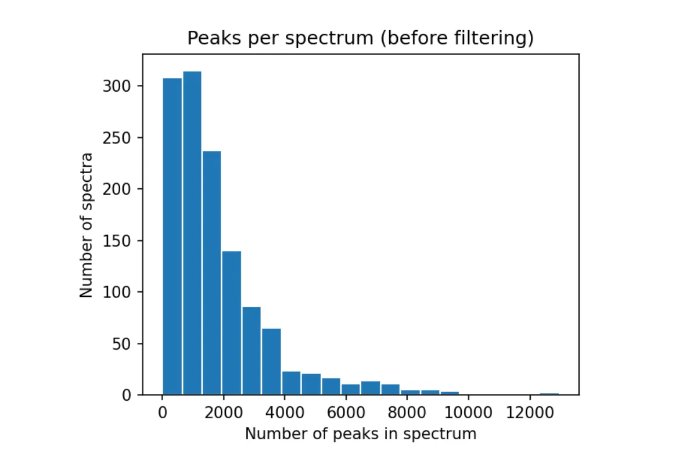
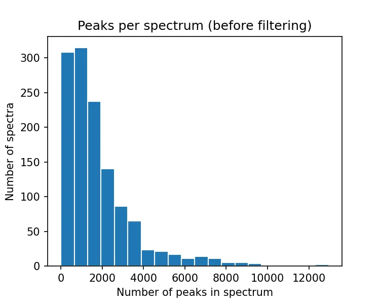
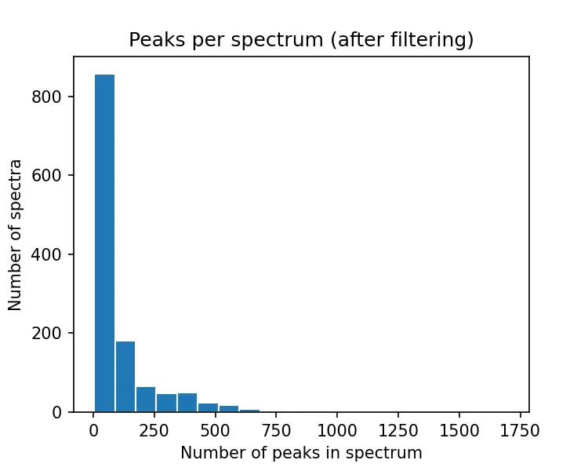
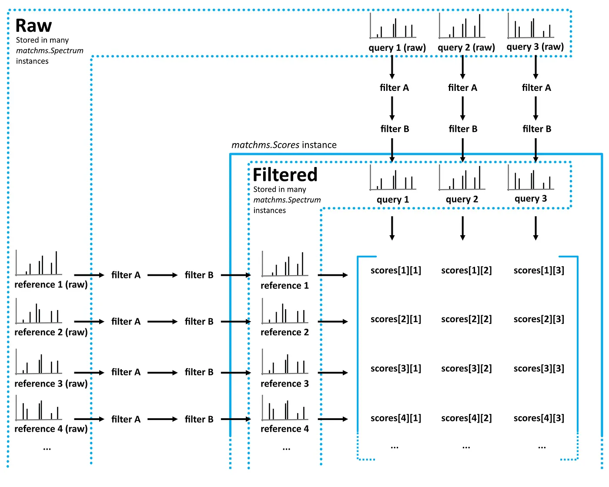
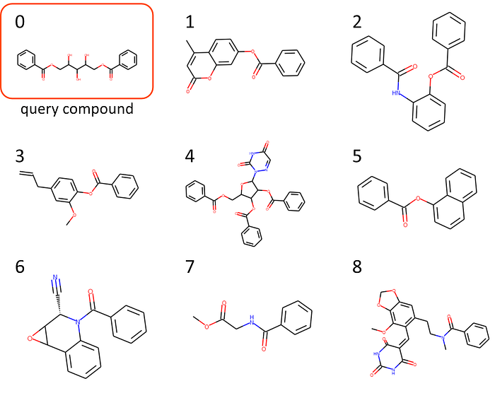
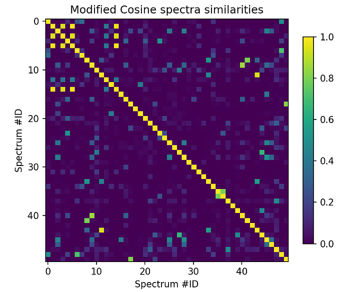
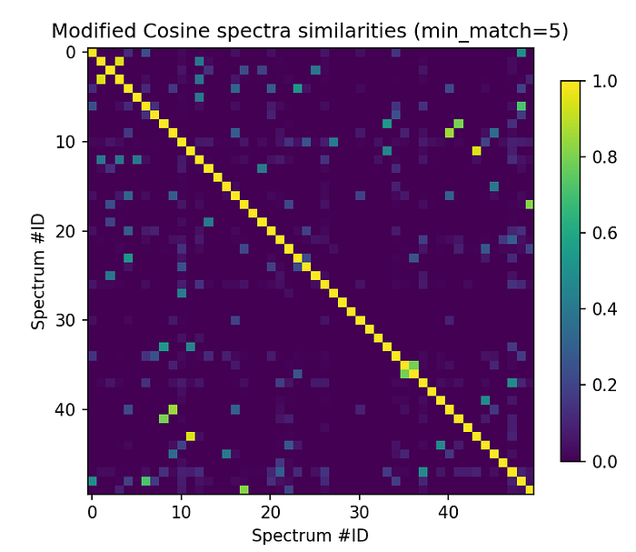
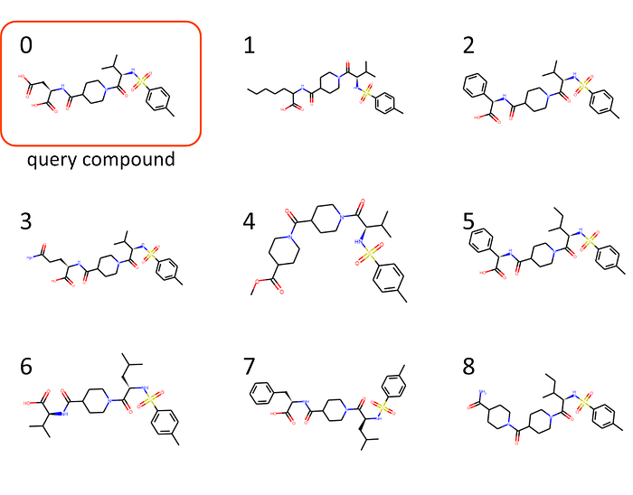

## Python is a very powerful language and brings the potential for designing computational mass spectrometry analysis workflows of any desired type and complexity. Here, you can find a quick introduction on how to import, process, and analyze a tandem mass spectra dataset using Python and matchms.

*[last edit: 31/01/2023 using matchms 0.18.0]*

Mass spectrometry data is at the heart of numerous applications in the biomedical and life sciences. With growing use of high-throughput techniques and increasing availability of public datasets, it becomes more and more important to find suitable ways for analyzing larger and more complex datasets.

Python is a great programming language for such data analysis. It gives access to very powerful, free, and well-documented libraries for handling and analyzing data, applying machine learning, or building complex data visualizations. However, using Python is definitely not (yet) a standard in the mass spec field! That’s why I here want to give a quick introduction on how to start building your own analysis pipeline in Python using our package [***matchms***](https://github.com/matchms/matchms).

### In this tutorial I will walk you through the following steps

0. Setting things up
1. Import MS/MS data
2. Build a data processing pipeline
3. Compute spectra similarities: Cosine score
4. Compute spectra similarities: Modified Cosine score

### Building on this tutorial there will be more parts, so far:

[part II — Compute spectra similarities using Spec2Vec](/posts/2023-01-31---build-a-mass-spectrometry-analysis-pipeline-in-python-using-/)

## 0. Setting things up

*(skip this part if you already know your way around Python)*

### First of all: get over this first frightening barrier of using Python

Only very little (or no) Python experience? You’re a researcher and are afraid your programming skills might not be enough? Don’t worry too much, plenty of researchers start exactly from that point. In my opinion, learning Python by tackling a concrete problem that you care about can be great way to make friends with Python (which you won’t regret doing!).

### Set things up:

The easiest way to work with Python is by using **Anaconda**. You can [download and install it from here](https://www.anaconda.com/products/individual). It is Python + a packaging manager (conda), and brings you everything you need to get started with Python including an editor (Spyder) and great tools to develop and prototype Python code (Jupyter Notebook, JupyterLab).
As for many researchers, using separate environments with conda might not be straightforward at first. That’s normal. But this is a good moment to get used to it. It essentially means you create an own Python environment with a particular Python version and the additional packages you need for your project. By doing so you will avoid that it will clash with any other Python project that you are doing now or in the future. You can do this with conda (which you have if you installed Anaconda), by running the following from the terminal:

```sh
conda create --name matchms python=3.8
conda activate matchms
conda install --channel bioconda --channel conda-forge matchms
```

What this does is: 1) Create a new environment with name “matchms” that has Python version 3.8. Then 2) you activate this environment after which you will be working “in” this environment until you switch to another one. And finally, 3) you install matchms in that environment which will also install all packages that matchms needs to run properly. Now we are ready start coding with matchms!

*(Obviously this is not enough to get you fully started with Python if you never worked with it before! Luckily there is a rapidly growing number of Python introduction courses, for instance the* [*carpentry-style courses*](https://software-carpentry.org/lessons/) *that become more frequent in academia. You can also chose from plenty of good online tutorials, e.g.* [*here*](https://www.w3schools.com/python/)*,* [*here*](https://www.learnpython.org/)*, and* [*here*](https://realpython.com/learning-paths/python3-introduction/)*. Or free online courses* [*such as this one on edx*](https://online-learning.harvard.edu/course/using-python-research?delta=0)*. Of course there are also plenty of good books to learn Python, for instance this free one on* [*data science with Python*](https://jakevdp.github.io/PythonDataScienceHandbook/)*).*

## 1. Import MS/MS data

***matchms*** can import MS/MS data from several common file formats such as *.mzml*, *.mzxml*, or GNPS-style *.mgf* files. Another option would be to use the [Universal Spectrum Identifier for mass spectra](https://www.biorxiv.org/content/10.1101/2020.12.07.415539v1.full).
Let’s start with some spectra that we download from GNPS in form of a *.mgf* file from [this GNPS website](https://gnps-external.ucsd.edu/gnpslibrary). For the following example we [downloaded this spectra library](https://gnps-external.ucsd.edu/gnpslibrary/GNPS-NIH-NATURALPRODUCTSLIBRARY.mgf).

```python
import os
from matchms.importing import load_from_mgf
path_data = "..."  # enter path to downloaded mgf file
file_mgf = os.path.join(path_data,
                        "GNPS-NIH-NATURALPRODUCTSLIBRARY.mgf")
spectrums = list(load_from_mgf(file_mgf))
```

Now you will have `spectrums` which is a Python list full of matchms-type `Spectrum` objects. When running `len(spectrums)` you can see that we have just imported 1267 mass spectra.

Each of those objects contains the spectrum metadata (`spectrum.metadata`) and the spectrum peaks (`spectrum.peaks` with `spectrum.peaks.mz` and `spectrum.peaks.intensities`). Say, you want to access the metadata of a particular spectrum in your list (for example the 5th spectrum). Then you can either call `spectrums[4].metadata` which will return a dictionary of all metadata information, or you can call `spectrums[4].get("smiles")` to only get the specific metadata entry for that particular spectrum.

### Inspect the data

Let’s inspect the data that we just imported a bit more. For instance by having a closer look at some key metadata entries such as smiles, InChIKey and InChIs. Here a bit of code to have a closer look at the InChIKey entries in the imported data:

```python
inchikeys = [s.get("inchikey") for s in spectrums]
found_inchikeys = np.sum([1 for x in inchikeys if x is not None])
print(f"Found {int(found_inchikeys)} inchikeys in metadata")
```

This will show that the metadata for the imported spectra do not contain InChIKey entries (no entries at all or no entries in the expected fields).

We can also inspect the data by plotting a histogram of how many peaks the spectra have.

```python
numbers_of_peaks = [len(s.peaks.mz) for s in spectrums]
from matplotlib import pyplot as plt
plt.figure(figsize=(5,4), dpi=150)
plt.hist(numbers_of_peaks, 20, edgecolor="white")
plt.title("Peaks per spectrum (before filtering)")
plt.xlabel("Number of peaks in spectrum")
plt.ylabel("Number of spectra")
```



Figure 1. Histogram of peaks per spectrum (before peak processing).

This reveals that most spectra here contain a lot of peaks (figure 1), most of which we expect to be low intensity noise peaks. In a next step we will further process the data and remove peaks below a set intensity threshold which will also drastically reduce the number of peaks per spectrum (see figure 2, right side).

### Export processed data

There are multiple options to export your data after processing. Using `save_as_json` or `save_as_mgf` the data can be written back to a `.json` or `.mgf` file.

```python
from matchms.exporting import save_as_json
file_export_json = os.path.join(path_data, "GNPS-NIH- NATURALPRODUCTSLIBRARY_processed.json")
save_as_json(spectrums, file_export_json)
```

A alternative that is much faster for reading/writing is to use `pickle`. Should data handling become an issue (e.g. many thousands spectrums), than this can be a way out.

```python
import pickle
file_export_pickle = os.path.join(path_data, "GNPS-NIH-NATURALPRODUCTSLIBRARY_processed.pickle")
pickle.dump(spectrums,
            open(file_export_pickle, "wb"))
```

## 2. Build a data processing pipeline

Depending on the data that you import, in most cases you might want to further process the spectra. ***matchms*** offers numerous ‘filters’ to process `Spectrum` objects. They are designed in a way that allows to simply stack them to any processing pipeline you want. In general, `matchms.filtering` contains filters that either will

- harmonize, clean, extend, and/or check the spectrum metadata
- process or filter spectrum peaks (e.g. remove low intensity peaks, or normalize peak intensities)


Since all those filtering functions will input but also output a `Spectrum` you can also easily write your own filtering function in Python and add it to your pipeline. Above we have seen that the imported spectra lack at least part of the metadata that we would expect and in addition they seem to contain a lot of peaks (suggesting that there are many noise peaks that could be removed). A typical preprocessing pipeline could consist of two parts, one to clean up the metadata and one to further process the peaks. The first part could look like this:

```python
import matchms.filtering as ms_filters
def metadata_processing(spectrum):
    spectrum = ms_filters.default_filters(spectrum)
    spectrum = ms_filters.repair_inchi_inchikey_smiles(spectrum)
    spectrum = ms_filters.derive_inchi_from_smiles(spectrum)
    spectrum = ms_filters.derive_smiles_from_inchi(spectrum)
    spectrum = ms_filters.derive_inchikey_from_inchi(spectrum)
    spectrum = ms_filters.harmonize_undefined_smiles(spectrum)
    spectrum = ms_filters.harmonize_undefined_inchi(spectrum)
    spectrum = ms_filters.harmonize_undefined_inchikey(spectrum)
    spectrum = ms_filters.add_precursor_mz(spectrum)
    return spectrum
```

Here we defined a sequence of filters to be applied to a spectrum, which will apply `default filters` (a bunch of standard operations to make metadata entries more consistent). Then we run a number of filters that look for inchi, inchikey, and smiles that ended up in wrong fields (`repair_inchi_inchikey_smiles`), and ultimately translate inchi, inchikey, and smiles into another wherever possible.

To process the peaks we define another pipeline:

```python
def peak_processing(spectrum):
    spectrum = ms_filters.default_filters(spectrum)
    spectrum = ms_filters.normalize_intensities(spectrum)
    spectrum = ms_filters.select_by_intensity(spectrum, intensity_from=0.01)
    spectrum = ms_filters.select_by_mz(spectrum, mz_from=10, mz_to=1000)
    return spectrum
```

Here we defined a sequence of filters which will normalize the intensities to values between 0 and 1, and finally only keep peaks if they have a normalized intensity > 0.01 and if they have a m/z position between 10 and 1000 Da.

Once defined in this way, we can easily apply this processing sequence to all imported `spectrums` by doing:

```python
spectrums = [metadata_processing(s) for s in spectrums]
spectrums = [peak_processing(s) for s in spectrums]
```

Now, let’s inspect the number of peaks per spectrum again. As you can see, the filtering (mostly the removal of peaks below 0.01 max intensity) has drastically reduced the number of peaks per spectrum (figure 2).





Figure 2. Histograms of the number of peaks per spectrum before (left) and after (right) the processing step.

Also the metadata was improved a lot and we now find inchikeys as we would expect. We can for instance run:

```python
inchikeys = [s.get("inchikey") for s in spectrums]
inchikeys[:10]
```

Which gives (instead of just a list of `None` like before):

```text
Out[]:
['XTJNPXYDTGJZSA-PKOBYXMFSA-N',
 'VOYWJNWCKFCMPN-FHERZECASA-N',
 'IRZVHDLBAYNPCT-UHFFFAOYSA-N',
 'OPWCHZIQXUKNMP-RGEXLXHISA-N',
 'GTBYYVAKXYVRHX-BVSLBCMMSA-N',
 'UVZWLAGDMMCHPD-UHFFFAOYSA-N',
 'XKWILXCQJFNUJH-DEOSSOPVSA-N',
 'JDZNIWUNOASRIK-UHFFFAOYSA-N',
 'RCAVVTTVAJETSK-VXKWHMMOSA-N',
 'KQAZJQXFNDOORW-CABCVRRESA-N']
```

## 3. Compute spectra similarities: Cosine score

Computing spectra similarities is one of the core functionalities of ***matchms***. The overall workflow is displayed in the figure 3:



Figure 3: Flowchart of matchms workflow. Reference and query spectrums are filtered using the same set of set filters (here: filter A and filter B). Once filtered, every reference spectrum is compared to every query spectrum using the matchms.Scores object.

Here, we want to compare all spectra with each other to find out which ones are similar to each other. For this we will first have to chose a similarity score type and set the parameters the way we want. We’ll start with the ‘Cosine score’ which multiplies matching peaks and is meant to find (nearly-) identical spectra. Importing the function and setting the parameter(s) goes like this:

```python
from matchms import calculate_scores
from matchms.similarity import CosineGreedy
similarity_measure = CosineGreedy(tolerance=0.005)
```

Then, we can do the computation to the Cosine scores for all possible spectrum pairs (1267 x 1267 pairs). Since the similarity scores for pair_i_j is the same as pair_j_i, we set `is_symmetric=True` to speed up calculations a bit. Still, the next step means calculating about 800,000 cosine scores which might take a bit (few to a few dozens of minutes):

```python
scores = calculate_scores(spectrums, spectrums, similarity_measure, is_symmetric=True)
```

As a result, we get a `Scores` object which contains the spectra and all scores. The actual scores are stored in `scores.scores` and since we use the Cosine score this will contain both the Cosine similarity score and the number of matches. **Since matchms 0.18.0 scores are stored as a stacked sparse array** (so that the following code looks a little different from older versions).

Let’s first inspect what scores we have by running:

```python
scores.score_names
```

Let’s inspect some of the number of matching peaks by first converting our sparse score array into a regular Numpy array and then slicing the first 5x5 entries:

```python
scores_array = scores.scores.to_array()
scores_array[:5, :5]["CosineGreedy_score"]
```

or access the corresponding number of matching peaks by running:

```python
scores_array = scores.scores.to_array()
scores_array[:5, :5]["CosineGreedy_matches"]
```

### Get most similar spectra for spectrum of interest

If we want to see which spectra are most similar to the i-th spectrum (according to the here used Cosine score), then we can call:

```python
best_matches = scores.scores_by_query(spectrums[5], name="CosineGreedy_score", sort=True)[:10]
print([x[1] for x in best_matches])
```

which returns the scores for the top-10 candidates (Cosine score + number of matching peaks):

```text
Out[]:
[(1., 30),
 (0.99711049, 2),
 (0.99534901, 2),
 (0.99214557, 2),
 (0.98748381, 2),
 (0.98461111, 3),
 (0.98401833, 2),
 (0.97598497, 2),
 (0.9757458, 2),
 (0.97547771, 2)]
```

The first, highest ranked results is the spectrum itself, but what are those other candidates, all with pretty high Cosine scores? Let’s find out by looking at the respective smiles ([smiles](https://en.wikipedia.org/wiki/Simplified_molecular-input_line-entry_system) are notations for the chemical structure of the compounds):

```python
[x[0].get("smiles") for x in best_matches]
```

which here returns:

```text
Out[]:
['OC(COC(=O)c1ccccc1)C(O)C(O)COC(=O)c2ccccc2',
 'Cc1cc(=O)oc2cc(OC(=O)c3ccccc3)ccc12',
 'O=C(Nc1ccccc1OC(=O)c2ccccc2)c3ccccc3',
 'COc1cc(CC=C)ccc1OC(=O)c2ccccc2',
 'O=C(OCC1OC(C(OC(=O)c2ccccc2)C1OC(=O)c3ccccc3)n4ncc(=O)[nH]c4=O)c5ccccc5',
 'O=C(Oc1cccc2ccccc12)c3ccccc3',
 'O=C(N1[C@@H](C#N)C2OC2c3ccccc13)c4ccccc4',
 'COC(=O)CNC(=O)c1ccccc1',
 'COc1c2OCOc2cc(CCN(C)C(=O)c3ccccc3)c1C=C4C(=O)NC(=O)NC4=O',
 'COc1c2OCOc2cc(CCN(C)C(=O)c3ccccc3)c1/C=C\\4/C(=O)NC(=O)N(C)C4=O']
```

For those who are not used to reading smiles all the time (like me), let’s display the structures. There are many online and offline tools for plotting structures from smiles. Here, I used the Python package [rdkit](https://www.rdkit.org/) for it by running:

```python
from rdkit import Chem
from rdkit.Chem import Draw
for i, smiles in enumerate([x[0].get("smiles") for x in    best_matches]):
    m = Chem.MolFromSmiles(smiles)
    Draw.MolToFile(m, f"compound_{i}.png")
```



Figure 4.** Compounds of the highest 9 Cosine scores within the dataset with respect to spectrums[5], the first being the spectrum of interest itself (hence named “query compound”).

### Alternative: Get best matches above ‘min_match’ threshold

Maybe having two matching peaks is not good enough and you want to be more certain of your Cosine score based candidates. Let’s then only consider the best Cosine scores for which we have at least min_match* matches:

```python
min_match = 5
sorted_matches = scores.scores_by_query(spectrums[5], name="CosineGreedy_score", sort=True)
best_matches = [x for x in sorted_matches if x[1]["CosineGreedy_matches"] >= min_match][:10]
[x[1] for x in best_matches]
```

which will give a very different result than the previous run. Here we do not find any other spectrum in the dataset that shows a very high Cosine score (again, except the first entry which is the similarity of the spectrum with itself and hence obviously = 1):

```text
Out[]:
[(1., 30),
 (0.44857215, 6),
 (0.39605775, 5),
 (0.33880658, 5),
 (0.03942863, 6),
 (0.03429136, 5),
 (0.03028157, 5),
 (0.02845932, 5),
 (0.01924283, 7),
 (0.01890612, 5)]
```

## 4. Compute spectra similarities: Modified Cosine score

The modified cosine score aims at quantifying the similarity between two mass spectra. Unlike the Cosine score it does not only look at nearly identical spectra, but also considers the mass shift between two compounds. The score is calculated by finding best possible matches between peaks of two spectra. Two peaks are considered a potential match if their m/z ratios lie within the given ‘tolerance’, or if their m/z ratios lie within the tolerance once a mass-shift is applied. The mass shift is simply the difference in precursor-m/z between the two spectra. See [Watrous et al. (PNAS, 2012)](https://www.pnas.org/content/109/26/E1743) for further details.

As done above for the Cosine score, we can calculate the similarities for all possible spectrum pairs by running:

```python
from matchms.similarity import ModifiedCosine
similarity_measure = ModifiedCosine(tolerance=0.005)
scores = calculate_scores(spectrums, spectrums, similarity_measure,
                          is_symmetric=True)
```

Let’s then visualize the results for the first 50 x 50 spectrum pairs.

```python
scores_array = scores.scores.to_array()
plt.figure(figsize=(6,6), dpi=150)
plt.imshow(scores_array[:50, :50]["score"], cmap="viridis")
plt.colorbar(shrink=0.7)
plt.title("Modified Cosine spectra similarities")
plt.xlabel("Spectrum #ID")
plt.ylabel("Spectrum #ID")
```



Figure 5.** Modified Cosine scores for all possible pairs between the first 50 imported spectrums. As to be expected, the diagonal is always =1 (score for spectrum with itself). But also several other very high Modified Cosine scores stick out suggesting highly related spectra.Now, let’s accept Modified Cosine scores for a minimum number of matching peaks (min_match).

```python
min_match = 5
plt.figure(figsize=(6,6), dpi=150)
plt.imshow(scores_array[:50, :50]["ModifiedCosine_score"] \
           * (scores_array[:50, :50]["ModifiedCosine_matches"] >= min_match), cmap="viridis")
plt.colorbar(shrink=0.7)
plt.title("Modified Cosine spectra similarities (min_match=5)")
plt.xlabel("Spectrum #ID")
plt.ylabel("Spectrum #ID")
```



Figure 6.** Modified Cosine scores for all possible pairs between the first 50 imported spectrums (with ≥ 5 matching peaks!).There’s for instance a bright spot far outside the diagonal for `spectrums[11]` so let’s have a look at that one!

```python
min_match = 5
sorted_matches = scores.scores_by_query(spectrums[11], name="ModifiedCosine_score", sort=True)
best_matches = [x for x in sorted_matches if x[1]["ModifiedCosine_matches"] >= min_match][:10]
[x[1] for x in best_matches]
```

Which gives

```text
Out[]:
[(1., 151),
 (0.95295779, 15),
 (0.94542762, 13),
 (0.89735889, 17),
 (0.7886489, 12),
 (0.77433041, 9),
 (0.74935776, 8),
 (0.72854032, 8),
 (0.55896333, 7),
 (0.52331993, 9)]
```

And, probably more interesting, the corresponding smiles:

```python
[x[0].get("smiles") for x in best_matches]
Out[]:
['CC(C)[C@H](NS(=O)(=O)c1ccc(C)cc1)C(=O)N2CCC(CC2)C(=O)N[C@@H](CC(=O)O)C(=O)O',
 'CCCCCC(NC(=O)C1CCN(CC1)C(=O)[C@@H](NS(=O)(=O)c2ccc(C)cc2)C(C)C)C(=O)O',
 'CC(C)[C@H](NS(=O)(=O)c1ccc(C)cc1)C(=O)N2CCC(CC2)C(=O)N[C@H](C(=O)O)c3ccccc3',
 'CC(C)[C@H](NS(=O)(=O)c1ccc(C)cc1)C(=O)N2CCC(CC2)C(=O)N[C@@H](CCC(=O)N)C(=O)O',
 'COC(=O)C1CCN(CC1)C(=O)C2CCN(CC2)C(=O)[C@@H](NS(=O)(=O)c3ccc(C)cc3)C(C)C',
 'CCC(C)[C@H](NS(=O)(=O)c1ccc(C)cc1)C(=O)N2CCC(CC2)C(=O)N[C@H](C(=O)O)c3ccccc3',
 'CC(C)C[C@H](NS(=O)(=O)c1ccc(C)cc1)C(=O)N2CCC(CC2)C(=O)N[C@@H](C(C)C)C(=O)O',
 'CC(C)C[C@H](NS(=O)(=O)c1ccc(C)cc1)C(=O)N2CCC(CC2)C(=O)N[C@@H](Cc3ccccc3)C(=O)O',
 'CCC(C)[C@H](NS(=O)(=O)c1ccc(C)cc1)C(=O)N2CCC(CC2)C(=O)N3CCC(CC3)C(=O)N',
 'CCC(C)[C@H](NS(=O)(=O)c1ccc(C)cc1)C(=O)N2CCC(CC2)C(=O)N3CCC(CC3)C(=O)OC']
```

OK, smiles, nice. But let’s better move on and have a look at how those compounds actually look like (as above, plotted using rdkit):



Figure 7.** Compounds of the highest 9 modified Cosine scores within the dataset with respect to spectrums[11], the first being the spectrum of interest itself (hence “query compound”).I wouldn’t dare calling myself a natural product expert. But those chemical structures clearly do look more consistent to what we saw in Figure 4…

> 

Now it’s up to you to come up with things to do with this ;)

I hope this helped you getting started with using ***matchms*** for working with your MS/MS data! Soon there will be additional tutorials to go a bit more depth:

## Other parts of this tutorial

### [part I — Build you own mass spectrometry pipeline](/build-your-own-mass-spectrometry-analysis-pipeline-in-python-using-matchms-part-i-d96c718c68ee)

### [part II — Compute spectra similarities using Spec2Vec](/build-a-mass-spectrometry-analysis-pipeline-in-python-using-matchms-part-ii-spec2vec-8aa639571018)

### [part III — Network analysis based on spectra similarities](/build-a-mass-spectrometry-analysis-pipeline-in-python-using-matchms-part-iii-molecular-91891248ee34)

### matchms library

***matchms*** is freely available and open-source. You can find the [code on Github](https://github.com/matchms/matchms), the package is available as [conda package](https://anaconda.org/nlesc/matchms) (recommended) or [from pypi](https://pypi.org/project/matchms/). It was developed by a bunch of very nice people (see [here](https://github.com/matchms/matchms/blob/master/CITATION.cff)) and is [published in Joss](https://joss.theoj.org/papers/10.21105/joss.02411).

You can find more information in the [matchms documentation](https://matchms.readthedocs.io/en/latest/).

### Code

The code shown in this blog post can also be found as [a Jupyter notebook here](https://github.com/matchms/matchms/blob/tutorial/tutorial/matchms_tutorial_01_building_analysis_pipeline.ipynb).

### Help us develop matchms further!

We really hope that matchms will help people to build new, better analysis pipelines. So, please help us to further improve matchms. You can help us by **(1)** Cite our work if you use our package for your research: [matchms article in JOSS](https://joss.theoj.org/papers/10.21105/joss.02411).**(2)** Let us know if you run into any issues using matchms, or if you are missing any key functionalities! You can simply do so by starting a new issue on the [matchms GitHub repository,](https://github.com/matchms/matchms) or contact me on twitter [@me_datapoint](https://twitter.com/me_datapoint?lang=en).**You are of course more than welcome to also become an active contributor to the package and help extend its functionality!
(3)** Please let us know if you successfully applied matchms in your research project (makes us happy + we can maybe share the good news!).

Thanks a lot!

I would like to thank [Carlos Martinez-Ortiz,] [Jorislouwen], Niek de Jonge, [Justin van der Hooft] for helpful comments and suggestions on this blog post.
