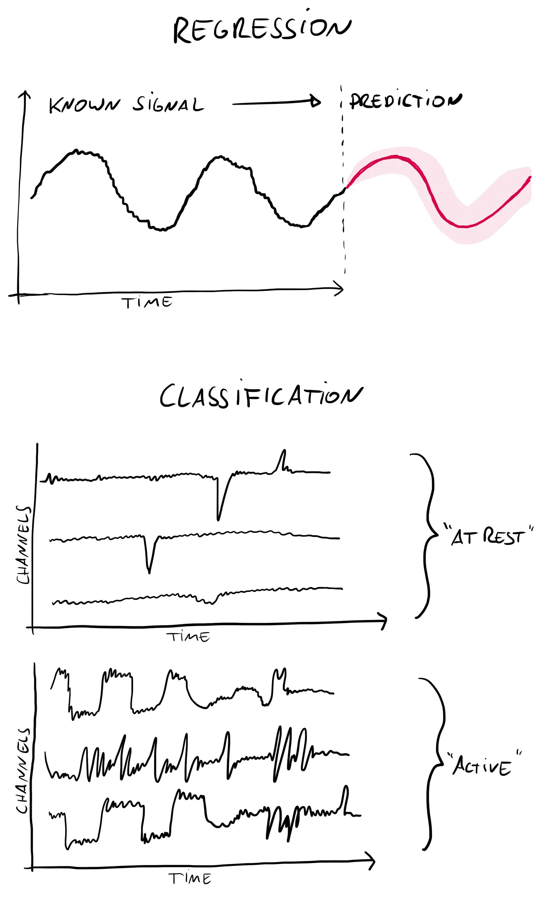
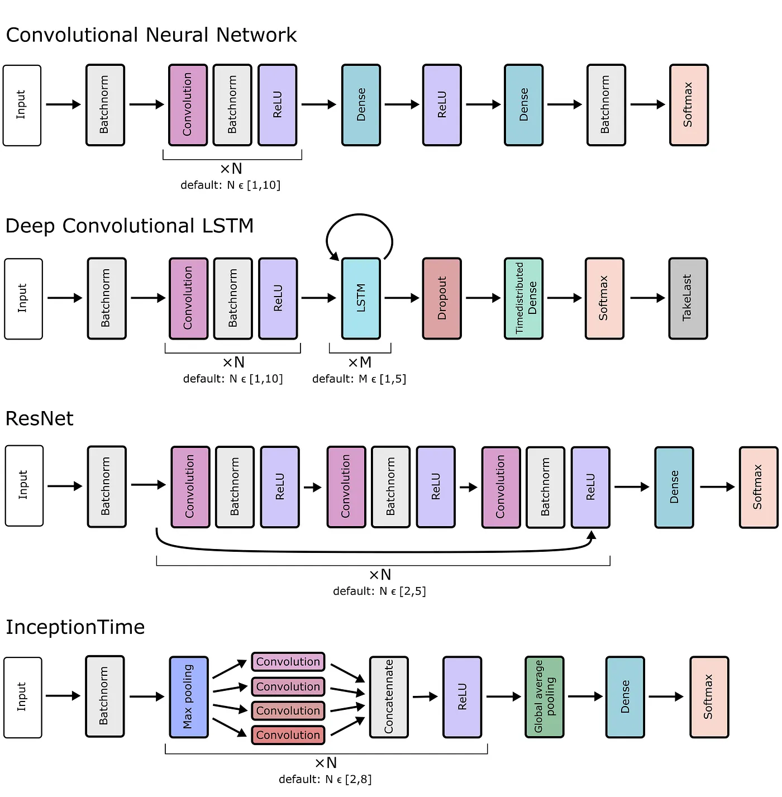

## A new mcfly 3.0 release is out. See how it works and how it can help you to apply deep learning to time series classification.

Time series data are everywhere. Motion sensor data, climate data, weather data, stock market data, population dynamics, sensor readings, etc. In machine learning, people working with time series are usually trying to solve either a **regression** task or a **classification** task.

A regression task is when you want to predict how a known time series will continue. What will the stock market look like tomorrow, or more likely over the next few microseconds? What will the temperature be tomorrow, or how will the arctic sea ice concentration develop over the next few weeks?



Time series REGRESSION and CLASSIFICATION are typical machine-learning tasks which can also be done using deep learning. Regression refers to making predictions on the continuation of a times series, classification is the task to sort given time series into a given number of classes (e.g. here it could be motion sensor data and we want to tell if the respective person was resting or active).

A classification task is when you want to sort a given time series into known classes. Is a patient with a certain heart beat recording healthy or not? What kind of activity is being revealed by motion sensor data? Is an oxygen sensor signal showing more or fewer people in the office?

### In the following it will all be about classification of time series.

Classifying time series is not a novel task, so it should come as no surprise that there are plenty of techniques and algorithms to classify such data. But just an in many other fields, deep learning has recently changed this game drastically. Whereas in the past a number of algorithms with long lists of skillfully set parameters might have done the job, now more and more deep learning tools have begun to outperform conventional/classical techniques.

### Would you perhaps love to test whether deep learning could help you with your own classification problem, but you aren’t a deep learning practitioner?

No false promises. It can be hard to apply deep learning tools properly. Not so much on the technical level, as I will show you in a second, but from a statistical and mathematical standpoint. But for now just ignore all those concerns. All you want to do is test whether deep learning can give you decent results on your dataset.


## And that can indeed be super simple. How? Just use mcfly.

***mcfly*** is a Python library developed [by the Netherlands eScience Center](https://www.esciencecenter.nl/) to generate a bunch of deep learning networks for you and to train them on your dataset. We recently released version 3.0 which comes with more deep learning architectures and runs on newer Python libraries. The main goal of ***mcfly*** is to: (1) provide a quick entry point to the field of deep learning, and (2) quickly give you a first guesstimate of how (and if!) deep learning can help with your problem.

### What is needed?

1. You will need Python (3.5 or higher). Then simply pip install ***mcfly***:
   `pip install mcfly`
2. Next you need a time series dataset to work on.
   Your dataset should contain samples belonging to different categories (or classes) with multiple samples per categories. The more samples per category, the better, but how many samples your dataset *must* have for deep learning to work is difficult to answer. The more categories you have, and the smaller the differences between those are, the more samples are needed for deep learning models to (hopefully) pick up the subtle differences in the patterns.

### Let’s do some deep learning now…

For a quick start let’s use a simple data set to figure out how it all works. For this purpose I selected a very simple motion sensor data set called “RacketSports”. It consists of mobile phone motion sensor data taken when playing either squash or badminton. The goal here is to correctly tell from a given motion sensor time series what the person was doing, with four possible classes in the data set:

```text
Squash_BackhandBoast
Squash_ForehandBoast
Badminton_Smash
Badminton_Clear
```

The [dataset is publicly available here](http://www.timeseriesclassification.com/description.php?Dataset=RacketSports). I downloaded it, split it into training, validation, and test set and saved it as numpy arrays. The processed files [can now be found on zenodo](https://zenodo.org/record/3743603), or even simpler just import them from our [mcfly-tutorial](https://github.com/NLeSC/mcfly-tutorial). If you clone the mcfly-tutorial repo you can run the following:

```python
import sys
import os
import numpy as np
import pandas as pd

# mcfly
import mcfly
import tensorflow as tf
np.random.seed(2)
```

```python
sys.path.insert(0, os.path.abspath('../..'))
from utils import tutorial_racketsports
```

```python
# Specify in which directory you want to store the data:
directory_to_extract_to = os.path.join('.', 'data')
```

```python
data_path = tutorial_racketsports.download_preprocessed_data(directory_to_extract_to)
```

```python
X_train, y_train, X_val, y_val, X_test, y_test = tutorial_racketsports.load_data(data_path)
```

[Snippet from a much more extensive mcfly tutorial notebook.](https://github.com/NLeSC/mcfly-tutorial/blob/bbd7881a27dd74f2e991cd5c0da8e6774c2dc808/notebooks/tutorial/tutorial_quick.ipynb)

This will give you 3 arrays with the data for training, validation, and testing, together with 3 arrays of the corresponding labels. Those, however, are still stings and need to be translated into binary labels. For instance like this:

```python
labels_unique = list(set(y_train))
print(labels_unique)
```

```python
from sklearn import preprocessing
lb = preprocessing.LabelBinarizer()
lb.fit(labels_unique)
lb.classes_
```

```python
y_train_binary = lb.fit_transform(y_train)
y_val_binary = lb.fit_transform(y_val)
y_test_binary = lb.fit_transform(y_test)
```

[Snippet from a much more extensive mcfly tutorial notebook.](https://github.com/NLeSC/mcfly-tutorial/blob/bbd7881a27dd74f2e991cd5c0da8e6774c2dc808/notebooks/tutorial/tutorial_quick.ipynb)

### Generate deep learning models using mcfly

This is the heart of ***mcfly***. It will generate `number_of_models` models for you. These are built from four different types of deep learning architectures, which are displayed in the figure below. They all have different pros and cons. One of the purposes of ***mcfly*** is to quickly test those architectures and see if some work better than others on a given problem. If you want to select only one or a few of those model types, simply add to the function: `model_types = ['CNN', 'DeepConvLSTM']` containing the types you want.



Mcfly (from v3.0 on) generates four different types of deep learning networks for time series classification. Figure appeared in [Kuppevelt et al., 2020, doi: 10.1016/j.softx.2020.100548]

For all those four architecture types, ***mcfly*** randomly chooses the key hyperparameters within a set range. Those ranges can also be adjusted manually of course (see ***mcfly*** documentation).

```python
num_classes = y_train_binary.shape[1]
metric = 'accuracy'
models = mcfly.modelgen.generate_models(X_train.shape,
                                        number_of_classes=num_classes,
                                        number_of_models = 8,
                                        metrics=[metric])
```

Once the models are generated, they will be trained on the given data (or a subset to speed things up). This is done using `train_models_on_samples`.

```python
# Define directory where the results, e.g. json file, will be stored
resultpath = os.path.join(directory_to_extract_to, 'models')
if not os.path.exists(resultpath):
    os.makedirs(resultpath)
```

```python
from mcfly.find_architecture import train_models_on_samples

outputfile = os.path.join(resultpath, 'modelcomparison.json')
histories, val_accuracies, val_losses = train_models_on_samples(X_train, y_train_binary,
                                                                X_val, y_val_binary,
                                                                models, nr_epochs=20,
                                                                subset_size=300,
                                                                early_stopping_patience = 5,
                                                                verbose=True,
                                                                outputfile=outputfile,
                                                                metric=metric)
print('Details of the training process were stored in ',outputfile)
```

[See full tutorial notebook for more information.](https://github.com/NLeSC/mcfly-tutorial/blob/master/notebooks/tutorial/tutorial_quick.ipynb)

The performance of the trained models can then interactively be compared using mcfly***, for example by comparing the accuracy on the validation set versus a number of key hyperparameters (see screenshot below). The built-in visualization is interactive and allows to select specific models (here numbered 0 to 7), or select specific architectures (here ‘CNN’ or ‘InceptionTime’), or learning rates. Most important feature to look at are the two plots on the top which display the development of the accuracy on both the training set and the validation set. A good model should perform decently well on both sides.

mcfly build-in visualization of the model performance. While in this example all models achieve good results on the training dataset, much fewer reach decent results on the validation dataset.

### Overfitting

Since the RacketSports dataset only consits of 150 training examples, you will frequently see that generated deep learning models will **overfit** the data. Overfitting is one of the most common problems when working with deep learning. It essentially means that you optimize too much on the training data so that the performance on unseen data will suffer. A typical signature for this is that models will do well on the training data (high training accuracy), but will perform poorly on the validation data (low validation accuracy). A typical example is shown below with 8 models, most of which report high `train_accuracy`but very low `val_accuracy`values!

Example results of 8 mcfly generated models trained on RacketSports dataset. Six perform well on the training data, but only 2 models also perform well on the validation data.If we now pick one of the better performing models (or iteratively generate and train more models), then we can get quite good results on the RacketSports dataset. Below you can see how we could inspect this by generating a confusion matrix. And here it indeed reveals that most of the times the picked **model is correctly predicting the actual activity!**

```python
## Inspect model predictions on validation data
datasize = X_val.shape[0]
probs = models[0][0].predict(X_val[:datasize,:,:],batch_size=1)  # here a different model was chosen!
```

```python
#columns are predicted, rows are truth
labels = lb.classes_

predicted = probs.argmax(axis=1)
y_index = y_val_binary.argmax(axis=1)
confusion_matrix = pd.crosstab(pd.Series(y_index), pd.Series(predicted))
confusion_matrix.index = [labels[i] for i in confusion_matrix.index]
confusion_matrix.columns = [labels[i] for i in confusion_matrix.columns]
confusion_matrix.reindex(columns=[l for l in labels], fill_value=0)
confusion_matrix
```

Generating a confusion matrix using the validation dataset.

### And now… what are you waiting for?

Grab some interesting time series data and try out some deep learning!

## Did you use mcfly?

Awesome! We are always happy to hear from people who have made good use of ***mcfly***. Please get in touch if you have suggestions and ideas for future developments or fixes (e.g. via [GitHub](https://github.com/NLeSC/mcfly), via[ twitter](https://twitter.com/me_datapoint), or as response to this post). Many thanks.

**Reference:
**D. van Kuppevelt, C. Meijer, F. Huber, A. van der Ploeg, S. Georgievska, V.T. van Hees. *Mcfly: Automated deep learning on time series.* SoftwareX, Volume 12, 2020. [doi: 10.1016/j.softx.2020.100548](https://doi.org/10.1016/j.softx.2020.100548)

## Links

* [Former blog post from 2017](/mcfly-time-series-classification-made-easy-e47de8d29838) by [Dafne van Kuppevelt]
* ***mcfly*** on pypi: [https://pypi.org/project/mcfly/](https://pypi.org/project/mcfly/)
* ***mcfly*** on GitHub: [https://github.com/NLeSC/mcfly](https://github.com/NLeSC/mcfly)
* Ready-to-use RacketSports dataset on zenodo: [https://zenodo.org/record/3743603](https://zenodo.org/record/3743603#.XpAypXKxUuU)
* ***mcfly*** tutorial(s): [https://github.com/NLeSC/mcfly-tutorial](https://github.com/NLeSC/mcfly-tutorial)
* Tutorial notebook with all code mentioned in this blog post: **[https://github.com/NLeSC/mcfly-tutorial/blob/main/notebooks/tutorial/tutorial_quick.ipynb](https://github.com/NLeSC/mcfly-tutorial/blob/main/notebooks/tutorial/tutorial_quick.ipynb)

*mcfly**** *was developed at the [**Netherlands eScience Center**](https://www.esciencecenter.nl/) by [Dafne van Kuppevelt], Christiaan Meijer, [Sonja Georgievska], [Vincent van Hees], [Florian Huber], [Patrick Bos], [Jurriaan H. Spaaks], Mateusz Kuzak, [Johan Hidding], [Atze van der Ploeg].

Thanks to Johan Rheeder, [Sonja Georgievska], [Dafne van Kuppevelt], [Peter Kalverla,] [Patrick Bos], and [Tom Bakker] for helpful comments and edits.
